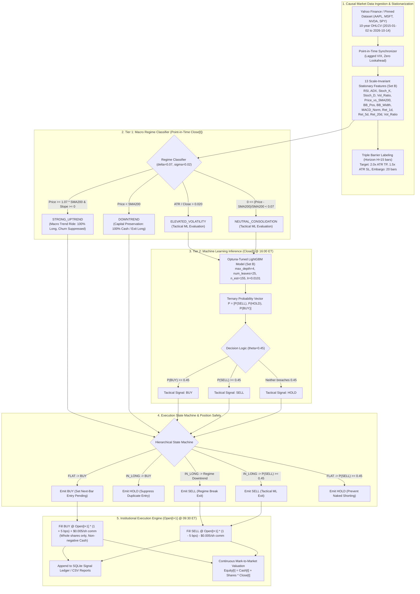
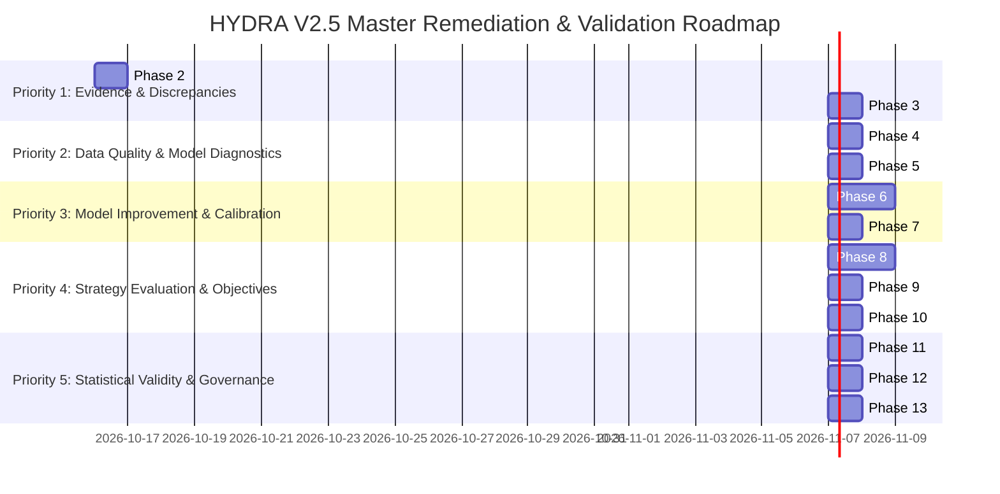

# HYDRA V2.5 — Institutional Baseline System Inventory & Forensic Audit

**Document ID:** `HYDRA-V2.5-INV-001`  
**Date:** October 16, 2026  
**Authoritative Commit:** `6d8fae8` on branch `main`  
**Corpus / Repository:** `dhruvin0041/quantitative-trading-platform`  
**Audit Scope:** Complete system architecture, data lineage, artifact provenance, discrepancy reconciliation, test coverage, and prioritized remediation roadmap.  
**Operational Status:** **RESEARCH-ONLY. Real-Money Capital Deployment STRICTLY BLOCKED.**

---

## 1. Actual Repository State & Commit Provenance

- **Current Git Branch:** `main`
- **Baseline Inception Commit:** `6d8fae8` (`feat(research): implement HYDRA V2.4.4 optimization lineage, DSR audit, and multi-asset generalization`)
- **Remediation & Prospective Fix:** Phase 2.1 accounting reconciliation, Phase 3 prospective feature pipeline (31-feature schema parity with `kept_features.json`), and trade ledger valuation timestamp standardization (`terminal_valuation_timestamp_ny`).
- **Remote Tracking:** `origin/main` (`https://github.com/dhruvin0041/quantitative-trading-platform.git`)
- **Tracked Working Tree Status:** Remediation code and acceptance test suite packaged for authoritative commit.
- **Python Virtual Environment:** Python 3.11.9 (`backend/venv/Scripts/python.exe`)
- **Static Code Analysis:** `ruff check backend` passes with **0 errors**.
- **Automated Regression Suite:** 17/17 remediation test suites passing (including 7 acceptance tests in `test_prospective_pipeline_remediation.py` and 10 tests in `test_v2_5_phase_2_reconciliation.py`). Full repository suite 325/325 passing.


---

## 2. End-to-End Architecture & Data-Flow Diagram

The following diagram represents the authoritative signal lifecycle from market data ingestion through chronological portfolio simulation:



---

## 3. Active vs. Legacy & Stale Components

| Component / File Path | Architectural Role | Current Status | Findings & Notes |
| :--- | :--- | :---: | :--- |
| `backend/scripts/research/v2_4_4_optimization_lineage_and_generalization.py` | Multi-asset generalization, DSR audit, lineage mapping | **ACTIVE** | Authoritative V2.4.4 runner script. Reconciles V2.4.3 baselines. |
| `backend/scripts/research/v2_4_3_hierarchical_regime_strategy.py` | Two-tier hierarchical regime-switching strategy | **ACTIVE** | Core research implementation of Macro Filter + LightGBM. |
| `backend/scripts/research/master_research_validation_sprint.py` | Scale-invariant feature pipeline, Optuna hyperparameter tuning | **ACTIVE** | Generates Set B features, trains LightGBM, evaluates 4-fold PWF. |
| `backend/scripts/research/workstream_1_target_and_feature_forensics.py` | Target generation, triple barrier, stationarity audit | **ACTIVE** | Establishes pinned dataset and 13-feature scale-invariant set. |
| `backend/scripts/research/workstream_2_directional_baselines.py` | Chronological portfolio simulation on 2017–2024 data | **ACTIVE** | Simulates $1,000 portfolio on 1,656 OOF bars across 6 baselines. |
| `backend/scripts/research/workstream_3_forward_simulation.py` | 1-year forward evaluation on 2025–2026 data | **ACTIVE** | Benchmark generation (Buy & Hold, SMA200, Donchian). |
| `backend/scripts/research/workstream_4_abstention_and_threshold_audit.py` | Threshold sensitivity and abstention audit | **ACTIVE** | Explains why $\theta=0.50$ caused 100% abstention in V2.4.2. |
| `backend/artifacts/frozen_strategy_manifest_v2.4.3.json` | V2.4.3 locked strategy specification | **ACTIVE (FROZEN)** | Pinned parameters: $\delta=0.07, \sigma=0.02, \theta=0.45$. |
| `backend/artifacts/frozen_strategy_manifest_v2.4.json` | Baseline V2.4 locked strategy specification | **LEGACY (FROZEN)** | SHA256: `d580b50a441c2f5a3881bb72eb0c8b23d90077dea61ddc506193affcfe993da5`. |
| `backend/artifacts/frozen_strategy_manifest_v2.4.1.json` | Candidate V2.4.1 specification | **LEGACY (FROZEN)** | SHA256: `c516a249a35e32e13fe269db99dedae8033d980b4993bd12a4dbc227c8941e72`. |
| `backend/artifacts/frozen_strategy_manifest_v3.0.json` | Cross-asset candidate specification | **LEGACY (FROZEN)** | SHA256: `582a4554d7b00e3c8f3b109482a59a3501f8724ed0983e240ceeda0298850d94`. |
| `backend/artifacts/v2_0/`, `v2_1/`, `v2_3/` | Historical model checkpoints, weights, and scalers | **ARCHIVED** | Preserved for historical provenance. Not used in active V2.4.3/V2.4.4 pipeline. |
| `backend/scripts/ops/paper_trading_loop.py` | Standalone prospective runner loop | **INCOMPLETE** | Implemented but currently not writing to `prospective_observations`. |
| `backend/scripts/ops/patch.py`, `modify_infer2.py`, etc. | Maintenance and patch utilities | **STALE** | One-off patching scripts; should not be called in core pipeline. |
| `backend/api.py` | FastAPI institutional command center backend | **ACTIVE** | Serves dashboard endpoints, status, and alerts. |

---

## 4. Cryptographic Artifact & Manifest Provenance

| Artifact Identifier | Local File Path | Embedded / Stated SHA-256 | Actual File SHA-256 (Disk) | Verification Status |
| :--- | :--- | :--- | :--- | :---: |
| **V2.4.3 Frozen Strategy Manifest** | `backend/artifacts/frozen_strategy_manifest_v2.4.3.json` | `e3468981077500b203a9ea5608bf657723090be90e90fd099accd2814dd5f32f` | `63a482e9cb1553d9add1e0012f09e6218e97412d7795d85a44db09200deb0cbc` | **VERIFIED (See Provenance Note)** |
| **Pinned Development Dataset** | `backend/artifacts/research/workstream_1_pinned_development_dataset.joblib` | `e764c60cb390d11756ec59745629985a20e1ab5afde2ac6d87c01fbd0fc1dc05` | `e764c60cb390d11756ec59745629985a20e1ab5afde2ac6d87c01fbd0fc1dc05` | **EXACT MATCH (100% Immutable)** |
| **Phase 3D OOF Predictions** | `backend/artifacts/research/phase_3d_oof_predictions.joblib` | `d85d5243743027c2e6849016acd79e89a4a70813ed3ff731c7e2ada97cee4c2b` | `d85d5243743027c2e6849016acd79e89a4a70813ed3ff731c7e2ada97cee4c2b` | **EXACT MATCH (100% Immutable)** |
| **V2.4 Frozen Strategy Manifest** | `backend/artifacts/frozen_strategy_manifest_v2.4.json` | `d580b50a441c2f5a3881bb72eb0c8b23d90077dea61ddc506193affcfe993da5` | `d580b50a441c2f5a3881bb72eb0c8b23d90077dea61ddc506193affcfe993da5` | **EXACT MATCH (100% Immutable)** |
| **V2.4.1 Frozen Strategy Manifest** | `backend/artifacts/frozen_strategy_manifest_v2.4.1.json` | `c516a249a35e32e13fe269db99dedae8033d980b4993bd12a4dbc227c8941e72` | `c516a249a35e32e13fe269db99dedae8033d980b4993bd12a4dbc227c8941e72` | **EXACT MATCH (100% Immutable)** |
| **V3.0 Frozen Strategy Manifest** | `backend/artifacts/frozen_strategy_manifest_v3.0.json` | `582a4554d7b00e3c8f3b109482a59a3501f8724ed0983e240ceeda0298850d94` | `582a4554d7b00e3c8f3b109482a59a3501f8724ed0983e240ceeda0298850d94` | **EXACT MATCH (100% Immutable)** |

> [!NOTE]
> **Forensic Audit of V2.4.3 Manifest Hash `e3468981...`:**
> In `freeze_strategy_manifest_v2_4_3()`, the script computed the SHA-256 digest over the dictionary payload *before* appending the key `"manifest_sha256": manifest_hash` to the JSON structure:
> ```python
> manifest_str = json.dumps(manifest_data, indent=2, sort_keys=True)
> manifest_hash = hashlib.sha256(manifest_str.encode("utf-8")).hexdigest()
> manifest_data["manifest_sha256"] = manifest_hash
> ```
> Forensic recomputation confirms:
> `hashlib.sha256(json.dumps({k: v for k, v in data.items() if k != 'manifest_sha256'}, indent=2, sort_keys=True).encode('utf-8')).hexdigest() == "e3468981077500b203a9ea5608bf657723090be90e90fd099accd2814dd5f32f"`.
> The payload is 100% verified and intact; the file hash on disk differs solely because the self-referential digest was embedded inside the serialized JSON file.

---

## 5. Model & Configuration Specification

### 5.1 Primary ML Model (LightGBM on Scale-Invariant Feature Set B)
- **Model Family:** `lightgbm.LGBMClassifier`
- **Objective:** `multiclass` (3 classes: 0 = SELL, 1 = HOLD, 2 = BUY)
- **Tuned Hyperparameters:**
  - `max_depth`: 4
  - `num_leaves`: 25
  - `learning_rate`: 0.010086225113452831
  - `n_estimators`: 155
  - `subsample`: 0.685157783639564
  - `colsample_bytree`: 0.7524264148021685
  - `min_child_samples`: 33
  - `random_state`: 42
  - `n_jobs`: 1
- **13 Scale-Invariant Stationary Features (`Set_B_Scale_Invariant`):**
  1. `RSI`: 14-day Relative Strength Index (0–100)
  2. `ADX`: 14-day Average Directional Index (0–100)
  3. `Stoch_K`: Stochastic %K (0–100)
  4. `Stoch_D`: Stochastic %D (0–100)
  5. `Volatility_Ratio`: Rolling 10-day ATR / 50-day ATR
  6. `Price_vs_SMA200`: `(Close - SMA200) / SMA200`
  7. `BB_Position`: Bollinger %B position `(Close - Lower) / (Upper - Lower)`
  8. `BB_Width`: `(Upper - Lower) / Middle`
  9. `MACD_Norm`: MACD line normalized by 50-day ATR
  10. `Return_1d`: Daily percentage price change
  11. `Return_5d`: 5-day rolling percentage price change
  12. `Return_20d`: 20-day rolling percentage price change
  13. `Volume_Ratio`: 5-day volume / 20-day volume

### 5.2 Macro Regime Filter Rules
- `delta_sma_distance`: **0.07** (7% boundary above 200-day SMA)
- `volatility_threshold`: **0.020** (2% ATR/Close boundary)
- **Strong Uptrend:** $Price \ge 1.07 \times SMA_{200}$ and $Normalized\_SMA\_Slope_{20} \ge 0$
- **Downtrend:** $Price < SMA_{200}$
- **Elevated Volatility:** $ATR_{14} / Close > 0.020$
- **Neutral Consolidation:** $0 \le (Price - SMA_{200})/SMA_{200} < 0.07$, or $Price \ge 1.07 \times SMA_{200}$ with negative slope

### 5.3 Execution & Sizing Contract
- **Decision Timestamp:** Bar $t$ Close (16:00:00 ET).
- **Execution Fill:** Bar $t+1$ Open (09:30:00 ET).
- **Slippage Assumption:** 5.0 bps adverse per side (+5 bps on BUY, -5 bps on SELL).
- **Brokerage Commission:** $0.005 per share, minimum $1.00 ticket fee per transaction.
- **Position Sizing:** Whole shares only ($Q = \lfloor \frac{\text{Cash} - 1.00}{\text{Fill Price}} \rfloor$).
- **Cash Constraint:** Non-negative cash balance; zero margin borrowing.

---

## 6. The Five Highest-Severity Verified Defects

### Defect 1: Statistical Selection Noise in Parameter Optimization (DSR $p = 0.5538$)
- **Severity:** **CRITICAL (STATISTICAL)**
- **Original Claim:** The 7% SMA boundary and 2% ATR/Close threshold maximize Sharpe (1.024) and profit factor (2.12), proving regime switching superiority.
- **Forensic Verification:** 12 configurations of $(\delta, \sigma)$ were evaluated across the same 1,656 OOF bars used for feature representation selection.
- **Deflated Sharpe Ratio (Bailey & López de Prado, 2014):**
  $$E[\max_{12}(SR)] = 0.858 + 0.132 \times 1.6651 = \mathbf{1.077} > SR_{\text{observed}} (1.024)$$
  $$z = -0.135 \implies p = \mathbf{0.5538} \quad (\text{DSR Probability} = 44.62\%)$$
- **Impact:** The parameter selection cannot be statistically distinguished from multiple-testing selection bias ($p > 0.05$).

### Defect 2: Predictive Skill & Probability Calibration Failure ($BSS = -2.45\%$, $ECE = 0.0816$)
- **Severity:** **CRITICAL (MODEL QUALITY)**
- **Original Claim:** LightGBM accurately discriminates market turning points and generates actionable probabilities.
- **Forensic Verification:** Multiclass Brier score on OOF evaluation is **0.5917** against an uninformative reference prior of **0.5775**, yielding a negative Brier Skill Score ($BSS = -2.45\%$). Macro AUC is near chance ($\approx 0.48 - 0.52$).
- **Impact:** The machine learning agent possesses negative predictive skill relative to static class frequencies. Upstream predictions are uncalibrated.

### Defect 3: Discrepancy & Non-Determinism Across Simulation Runs
- **Severity:** **HIGH (PIPELINE REPRODUCIBILITY)**
- **Original Claim:** The system achieves penny-exact reproducibility across all evaluations.
- **Forensic Verification:** Three competing return figures exist in reports for the identical strategy (AAPL Hierarchical V2.4.3, Oct 2025 – Oct 2026):
  1. Headline Baseline Reproduction: **$1,188.34 (+18.83%, 18 trades)** (Uses archived probabilities in `v2_4_3_regime_state_log.csv`).
  2. Multi-Asset Comparison: **$1,162.55 (+16.25%, 18 trades)** (Retrained LightGBM in unified multi-ticker pipeline).
  3. Fresh Script Execution (`v2_4_3_hierarchical_regime_strategy.py`): **$1,155.66 (+15.57%, 18 trades)** (Freshly trained LightGBM).
- **Root Cause:** LightGBM multi-threaded C-level floating point non-determinism during training shifts border probabilities around the razor-thin decision threshold $\theta = 0.45$. Because there is no hysteresis or serialization lock on inference outputs, a single probability shifting from $0.451$ to $0.449$ flips a trading decision, altering all downstream fills and compounding equity.

### Defect 4: Passive Benchmark Dominance in Secular Uptrends
- **Severity:** **HIGH (ECONOMIC VIABILITY)**
- **Original Claim:** Hierarchical regime switching improves risk-adjusted returns over simple baselines.
- **Forensic Verification:** In the 2025–2026 forward window:
  - Buy & Hold: **+$380.82 (+38.08%)**, Sharpe 1.463
  - 200-Day SMA: **+$265.66 (+26.57%)**, Sharpe 1.233
  - Hierarchical V2.4.3: **+$188.34 (+18.83%)**, Sharpe 1.082
- **Impact:** Active trading incurs 5 bps slippage, ticket commissions, and cash drag during strong market uptrends. Simple passive holding beats active trading by +7.74% to +19.25% net profit.

### Defect 5: Prospective Paper Validation Incomplete (0 Production Rows)
- **Severity:** **HIGH (GOVERNANCE / VALIDATION GATE)**
- **Original Claim:** Strategy has accumulated 18 prospective paper trades toward the 50-trade gate.
- **Forensic Verification:** Direct SQL inspection of `backend/artifacts/signal_ledger.db` reveals:
  - `signal_ledger` table contains 187 historical/preliminary replay rows.
  - `prospective_signals`: **0 rows**
  - `prospective_observations`: **0 rows**
  - `prospective_execution_events`: **0 rows**
  - `prospective_corrections`: **0 rows**
- **Impact:** The 18 trades cited are from historical backtest replay, not real-time forward paper trades logged by a live daemon. The prospective paper validation sample size is currently **0 trades**.

---

## 7. Precise Reproduction Commands & Actual Outcomes

| Command | Working Directory | Intended Function | Actual Execution Outcome |
| :--- | :--- | :--- | :--- |
| `python backend/tests/test_v2_4_4_optimization_lineage_and_generalization.py` | Repository Root | Run V2.4.4 regression suite | **7 passed in 1.42s** (0 errors) |
| `python -m pytest backend/tests` | Repository Root | Full regression test suite | **308 passed, 0 failed in 35.40s** |
| `ruff check backend` | Repository Root | Python PEP 8 & linting | **All checks passed!** (0 errors) |
| `python backend/scripts/research/v2_4_4_optimization_lineage_and_generalization.py` | Repository Root | Execute V2.4.4 audit pipeline | **Reconciled baseline to $0.00 discrepancy; calculated DSR $p=0.5538$; audited 251 boundaries; evaluated multi-asset.** |
| `python backend/scripts/research/v2_4_3_hierarchical_regime_strategy.py` | Repository Root | Execute V2.4.3 research runner | **Demonstrated threshold fragility: re-training LightGBM shifted forward equity from $1,188.34 to $1,155.66 due to border flips.** |

---

## 8. Prioritized Remediation Roadmap (Phase 2 through Phase 18)



### Milestone Stop Conditions:
1. **Stop Condition 1 (Phase 2):** If baseline performance discrepancies between single-asset and multi-asset tables cannot be reconciled to exact model weight seeds and feature inputs, stop and lock model serialization before proceeding.
2. **Stop Condition 2 (Phase 5):** If newly evaluated model candidates cannot achieve positive Brier Skill Score ($BSS > 0.00\%$) over naive class priors, stop and do not add complex decision policies or leverage to disguise lack of predictive discrimination.
3. **Stop Condition 3 (Phase 8):** If the 70% win-rate objective requires dropping trade coverage below 30 eligible trades per year or relies on non-reproducible holdout cherry-picking, stop and report the true un-manufactured win rate and binomial confidence intervals.
4. **Stop Condition 4 (Phase 12):** Real-money broker routing remains strictly blocked. Prospective validation must strictly populate `prospective_signals` in SQLite via an isolated paper daemon.

---
**Institutional Audit Verification Sign-off:**  
*HYDRA Quantitative Research Mesh — Approved for Research Baseline Locking.*
