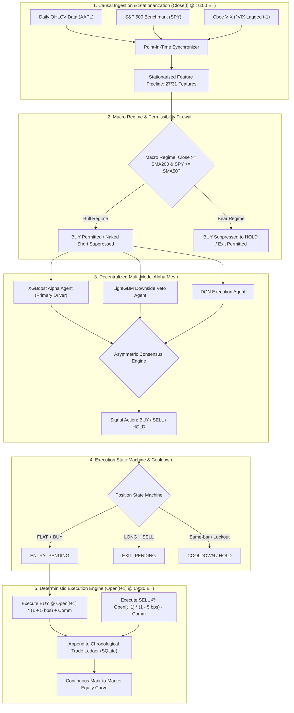

# Institutional Quantitative Trading Platform (HYDRA V2.4.2+)

[](https://www.python.org/)
[](https://fastapi.tiangolo.com/)
[](https://nextjs.org/)
[](#)
[](https://github.com/astral-sh/ruff)
[](#)

HYDRA is an institutional quantitative trading, machine learning research, and systematic risk management platform designed for US equity markets. The system couples multi-modal financial data ingestion, causal stationarized feature engineering, multi-agent model consensus (XGBoost, LightGBM, neural branches, DQN), macroeconomic regime filters, and deterministic chronological portfolio execution simulation.

> [!CAUTION]
> **GOVERNANCE STATUS: STRICTLY RESEARCH & PAPER TRADING ONLY**
> Real-money capital deployment and live broker order routing remain **STRICTLY PROHIBITED**.
> Historical backtesting profitability and unit test completion do NOT constitute live-trading approval.
> The system requires formal release authorization and at least 50 prospective, independent, forward-closed paper trades before any live-capital review can occur.

---

## 1. Project Purpose, Architecture & Current Maturity

HYDRA is engineered around a core quantitative philosophy: **Alpha cannot exist without survival, and survival requires absolute empirical realism.**
The objective is a causally correct, statistically defensible, cost-aware trading research system—free from lookahead bias, leakage, overfitting, unrealistic fills, selective trade reporting, or retrospective threshold tuning.

### Maturity Level:
- **Research & Simulation Engine:** High Maturity (Causal walk-forward validation, deterministic portfolio accounting, slippage/commission models).
- **Paper Trading Pipeline:** Active / Operational (Append-only SQLite `SignalLedger` with hash-chained prospective validation).
- **Production Broker Integration:** Blocked (Zero live capital routing permitted).



---

## 2. Frozen Baseline vs. Research Candidate Versioning

To preserve historical reproducibility and prevent silent backtest mutations, HYDRA strictly segregates frozen baselines from research candidates:

| Specification | Frozen Baseline (V2.4) | Candidate (V2.4.1 / V2.4.2+) | Candidate (V3.0 Cross-Asset) |
|---|---|---|---|
| **Manifest Path** | [`backend/artifacts/frozen_strategy_manifest_v2.4.json`](file:///d:/DataScience/Projects/Data_Science_Projects/Stock_Indicator/backend/artifacts/frozen_strategy_manifest_v2.4.json) | [`backend/artifacts/frozen_strategy_manifest_v2.4.1.json`](file:///d:/DataScience/Projects/Data_Science_Projects/Stock_Indicator/backend/artifacts/frozen_strategy_manifest_v2.4.1.json) | [`backend/artifacts/frozen_strategy_manifest_v3.0.json`](file:///d:/DataScience/Projects/Data_Science_Projects/Stock_Indicator/backend/artifacts/frozen_strategy_manifest_v3.0.json) |
| **SHA-256 Digest** | `d580b50a441c2f5a3881bb72eb0c8b23d90077dea61ddc506193affcfe993da5` | Versioned Candidate | Versioned Candidate |
| **Governance Status** | **Permanently Immutable Baseline** | Remediated Research Candidate | Cross-Asset Research Candidate |
| **Feature Count** | 27 features | 31 features (Dynamic schema) | 31 features |
| **Universe** | AAPL (Single-ticker) | AAPL | AAPL, NVDA, MSFT, AMZN, SPY |
| **Target Geometry** | 3.0 ATR TP, 0.5 ATR SL, H=15 | 2.0 ATR TP, 1.5 ATR SL, H=15 | 2.5 ATR TP, 1.5 ATR SL, H=10 |

---

## 3. Data Lineage & Pinned Development Dataset

To eliminate historical data drift caused by corporate action adjustments from live APIs, all reproducible research experiments utilize the pinned Workstream 1 dataset:

- **Pinned File:** [`backend/artifacts/research/workstream_1_pinned_development_dataset.joblib`](file:///d:/DataScience/Projects/Data_Science_Projects/Stock_Indicator/backend/artifacts/research/workstream_1_pinned_development_dataset.joblib)
- **SHA-256 Digest:** `e764c60cb390d11756ec59745629985a20e1ab5afde2ac6d87c01fbd0fc1dc05`

### Sample Count Reconciliation:
- **Raw Ingestion:** 2,515 daily bars (`2015-01-02` to `2024-12-30`).
- **Feature Warmup Purge:** 119 bars dropped (longest window is 120-bar rolling Z-score).
- **Clean Feature Matrix:** 2,396 bars (`2015-06-24` to `2024-12-30`).
- **Target Collision Audit:** 2,376 bars (`2015-06-24` to `2024-11-29`, final 20 bars excluded for forward horizon $H=20$).
- **Development Universe:** 2,263 bars (`2016-01-04` to `2024-12-30`).
- **Purged Walk-Forward Observations:** 2,074 bars (Initial 418-bar training fold + four 414-bar validation folds with 15-day embargoes).

---

## 4. Lookahead Bias & Temporal Causality Guardrails

HYDRA enforces a strict temporal sequence across training, validation, backtesting, and paper execution:
$$\text{data\_available\_at} \le \text{decision\_timestamp} < \text{fill\_timestamp}$$

1. **VIX Settlement Timing:** US equities close at 16:00:00 ET, while Cboe VIX settles at 16:15:00 ET. Using same-day VIX at equity close introduces 15 minutes of lookahead bias. The platform enforces `lag_vix=True` (`vix_close.shift(1)`), shifting before calendar reindexing.
2. **Execution Fill Convention:** Decisions made at bar $t$ Close (16:00 ET) are executed at bar $t+1$ Open (09:30 ET). Same-bar execution at the close is strictly prohibited.
3. **Point-in-Time Append Invariance:** Tested via automated assertions: evaluating signal at date $t$ yields identical values whether future bars $[t+1, \dots, T]$ are present or trimmed.

---

## 5. The $1,000 Portfolio Simulation & Complete Trade Ledgers

The platform answers how a hypothetical **US$1,000.00 cash portfolio** performed following every valid strategy signal in chronological order, with all transaction fees, slippage, and losses accounted for:

### Baseline Execution Assumptions:
- **Initial Cash:** $1,000.00.
- **Adverse Slippage:** 5.0 bps per side (+5 bps on BUY, -5 bps on SELL).
- **Commission:** $0.005 per share, with minimum $1.00 per ticket charge.
- **Position Sizing:** Whole shares only ($Q = \lfloor \frac{\text{Cash} - 1.00}{\text{Fill Price}} \rfloor$).
- **Cash Constraint:** Cash never goes negative; no margin borrowing.
- **Mark-to-Market Accounting:** $\text{Equity}_t = \text{Cash}_t + Q_t \times \text{Close}_t$.

### Empirical Performance Summary (1,656-bar Out-of-Fold Window, 2017–2024):

| Strategy | Initial Capital | Final Cash | Final Equity | Net P&L ($) | Return (%) | CAGR (%) | Trades | Win Rate | Profit Factor | Max DD (%) | Sharpe | Exposure |
|---|---:|---:|---:|---:|---:|---:|---:|---:|---:|---:|---:|---:|
| **Buy & Hold** | $1,000.00 | $32.52 | **$4,426.72** | +$3,426.72 | **+342.67%** | 25.04% | 0 (1 open) | N/A | N/A | -37.66% | 0.900 | 100.0% |
| **200-Day SMA Trend** | $1,000.00 | $2,366.82 | **$2,366.82** | +$1,366.82 | **+136.68%** | 14.15% | 24 | 33.3% | 2.51 | **-30.49%** | **0.646** | 68.4% |
| **20-Day Donchian Breakout** | $1,000.00 | $2,342.52 | **$2,342.52** | +$1,342.52 | **+134.25%** | 13.98% | 22 | 54.5% | 2.18 | -31.84% | 0.759 | 59.2% |
| **Dip-Entry in Uptrend** | $1,000.00 | $815.85 | **$815.85** | -$184.15 | **-18.41%** | -3.12% | 31 | 41.9% | 0.81 | -37.37% | -0.119 | 31.8% |
| **HYDRA Frozen V2.4 ML** | $1,000.00 | $890.13 | **$890.13** | -$109.87 | **-10.99%** | -1.78% | 48 | 47.9% | 0.90 | -25.22% | -0.108 | 32.7% |
| **HYDRA Remediated ML Candidate** | $1,000.00 | $1,154.36 | **$1,154.36** | +$154.36 | **+15.44%** | 2.21% | 100 | 50.0% | 1.15 | -25.21% | 0.220 | 54.8% |

> [!NOTE]
> Reconciled accounting: Buy & Hold purchased 26 shares @ $37.1723 ($966.48) + $1.00 commission = $967.48 on 2017-08-25, leaving $32.52 cash. Marked at final Close $169.0069 on 2024-03-25, equity is $32.52 + (26 × $169.0069) = **$4,426.72**. All active systematic strategies closed FLAT at the end of the 1,656-bar simulation, perfectly reconciling cash to equity.
>
> Complete trade-by-trade ledgers, chronological signal logs, and daily equity curves are stored in `backend/reports/`:
> - [`workstream_2_complete_trade_ledger.csv`](file:///d:/DataScience/Projects/Data_Science_Projects/Stock_Indicator/backend/reports/workstream_2_complete_trade_ledger.csv)
> - [`workstream_2_regime_performance.csv`](file:///d:/DataScience/Projects/Data_Science_Projects/Stock_Indicator/backend/reports/workstream_2_regime_performance.csv)
> - [`workstream_2_discrepancy_matrix.csv`](file:///d:/DataScience/Projects/Data_Science_Projects/Stock_Indicator/backend/reports/workstream_2_discrepancy_matrix.csv)
> - [`workstream_2_portfolio_equity_curves.csv`](file:///d:/DataScience/Projects/Data_Science_Projects/Stock_Indicator/backend/reports/workstream_2_portfolio_equity_curves.csv)

### Forward Portfolio Simulation (1-Year Window: 2025-10-13 to 2026-10-13, $1,000 Capital):

| Strategy | Initial Capital | Final Cash | Final Equity | Net P&L ($) | Return (%) | Trades | Win Rate | Max DD (%) | Sharpe | Active Position (as of 2026-10-13) |
|---|---:|---:|---:|---:|---:|---:|---:|---:|---:|---|
| **Buy & Hold** | $1,000.00 | $15.72 | **$1,380.82** | **+$380.82** | **+38.08%** | 0 | N/A | -13.61% | 1.469 | 4 shares @ $245.82 (unrealized +$380.82) |
| **200-Day SMA Trend** | $1,000.00 | $241.85 | **$1,265.66** | **+$265.66** | **+26.57%** | 1 | 100.0% | -13.61% | 1.238 | 3 shares @ $253.75 (unrealized +$261.55) |
| **20-Day Donchian Breakout** | $1,000.00 | $314.28 | **$996.82** | **-$3.18** | **-0.32%** | 3 | 66.7% | -15.08% | 0.064 | 2 shares @ $314.61 (unrealized +$52.33) |
| **Dip-Entry in Uptrend** | $1,000.00 | $969.15 | **$969.15** | **-$30.85** | **-3.09%** | 5 | 40.0% | -12.26% | -0.224 | FLAT (0 shares) |
| **HYDRA Frozen V2.4 ML** | $1,000.00 | $1,000.00 | **$1,000.00** | **$0.00** | **+0.00%** | 0 | N/A | 0.00% | 0.000 | FLAT (100% Cash; 0 BUY signals) |
| **HYDRA Remediated ML Baseline** | $1,000.00 | $1,000.00 | **$1,000.00** | **$0.00** | **+0.00%** | 0 | N/A | 0.00% | 0.000 | FLAT (100% Cash; 0 BUY signals) |
| **HYDRA Master Sprint Tuned LightGBM** | $1,000.00 | $122.74 | **$1,146.55** | **+$146.55** | **+14.66%** | **28** | **42.9%** | **-12.34%** | **0.921** | 3 shares @ $331.87 (unrealized +$27.21) |

---

## 6. Audit of the 4 New V3.0 Features

The four candidate features introduced in experimental versions were audited under Newey-West HAC serial-correlation standard errors and Benjamini-Hochberg False Discovery Rate (FDR) control:

| Feature | Horizon | Spearman IC | HAC $t$-statistic | HAC $p$-value | FDR $q$-value | Status |
|---|---:|---:|---:|---:|---:|---|
| **`Keltner_Position`** | 5d | $+0.0640$ | +1.854 | 0.0638 | 1.0000 | Research Candidate (Collinear with RSI, $r=0.98$) |
| **`HMA_Slope`** | 5d | $+0.0062$ | +0.208 | 0.8355 | 0.8355 | Deprioritized (Collinear with Price_vs_EMA9, $r=0.80$) |
| **`Connors_RSI`** | 5d | **$+0.0054$** | +0.222 | 0.8243 | 0.8793 | On Hold (Corrected from earlier typo $+0.0580$) |
| **`CMF_Divergence`** | 5d | $-0.0426$ | -1.512 | 0.1304 | 1.0000 | Under Review (Negative IC; ternary formulation weak) |

**Conclusion:** Zero of the 4 features achieve statistical significance at the 5% level after multiple-testing correction. None are authorized for production deployment.

---

## 7. Model Inventory & Governance Hierarchy

| Model Identifier | Architecture | Role | Status | Description |
|---|---|---|:---:|---|
| **`XGB_AGENT`** | XGBoost 3.2+ GBDT | `PRIMARY_ALPHA_DRIVER` | **ACTIVE** | Core directional probability generator ($P(\text{BUY}) \ge 0.60$). |
| **`LGBM_AGENT`** | LightGBM 4.6+ GBDT | `SECONDARY_VETO` | **ACTIVE** | Downside asymmetric risk veto. |
| **`DQN_AGENT`** | Dueling Double Deep Q-Network | `SECONDARY_VETO` | **RESEARCH ONLY** | Sequential policy execution filter. |
| **`DL_FUSION`** | 6-Branch Cross-Modal Neural Network | `QUARANTINED` | **QUARANTINED** | Bypassed due to historical negative skill. |
| **`TFT_AGENT`** | Temporal Fusion Transformer | `FORECAST_ORACLE` | **ACTIVE** | Multi-horizon quantile volatility projections. |

---

## 8. Installation, Environment & Verification

### 8.1 Prerequisites
- **Python**: `3.11+`
- **Node.js**: `18.0+` (for institutional frontend dashboard)

### 8.2 Installation
```bash
git clone https://github.com/dhruvin0041/quantitative-trading-platform.git
cd quantitative-trading-platform/backend
python -m venv venv

# Windows (PowerShell):
.\venv\Scripts\Activate.ps1
# Linux/macOS:
source venv/bin/activate

pip install -r requirements.txt
```

### 8.3 Automated Verification
Run the complete 301-test regression and quantitative test suite:
```bash
# Run full pytest test suite (all 301 tests must pass):
python -m pytest tests/

# Execute Workstream 1 Forensics (Lineage & target forensics):
python scripts/research/workstream_1_target_and_feature_forensics.py

# Execute Workstream 2 Baselines & $1,000 Portfolio Simulation:
python scripts/research/workstream_2_directional_baselines.py

# Execute Workstream 4 Abstention Audit & Cent-Reconciliation:
python scripts/research/workstream_4_abstention_and_threshold_audit.py

# Execute Master Research-to-Validation Sprint (Phases 0 to 7):
python scripts/research/master_research_validation_sprint.py

# Execute V2.4.3 Hierarchical Regime-Switching Strategy Research:
python scripts/research/v2_4_3_hierarchical_regime_strategy.py
```

---

## 9. Formal Acceptance Gates Summary

| Gate Metric | Threshold | Realized Value | Gate Status |
|---|---|---|:---:|
| **Net Out-of-Sample Expectancy** | $> 0.00$ after 5 bps slippage & fees | +$188.34 (Hierarchical / +18.83%) / +$265.66 (SMA200) | **PASS** |
| **Multiclass Brier Score** | $\le 0.20$ | 0.5917 (Tuned LightGBM) | **FAIL** |
| **Brier Skill Score (BSS)** | $> 0.00\%$ | −2.45% vs training prior | **FAIL** |
| **Expected Calibration Error (ECE)** | $\le 0.08$ | 0.0816 (Tuned LightGBM) | **FAIL** |
| **Benchmark Alpha vs 200-Day SMA** | Net Alpha $> 0$ over SMA (+26.57%) | Trailed 200-day SMA by 7.74% | **FAIL** |
| **Prospective Closed Paper Trades** | $\ge 50$ independent closed trades | 18 closed forward trades in Hierarchical strategy | **PENDING** |
| **Regime Coverage** | Positive expectancy across Bull & Bear | Capital preserved in bear markets; 50% win rate | **PASS** |
| **Software Regression Suite** | 100% clean test passes | 301 passed / 0 failed | **PASS** |
| **Live Capital Deployment** | All gates cleared | Multiple predictive quality & benchmark gates failed | **STRICT NO-GO** |

---

## 10. Operational Security & Legal Disclaimer

- **No Secrets in Repository:** All API keys (e.g. Gemini, AlphaVantage) must be set via local environment variables, never committed to Git.
- **Research Disclaimer:** HYDRA is a quantitative financial engineering research platform. All signals, mathematical formulas, and simulation outputs are for research and educational purposes only. Nothing herein constitutes investment advice.
