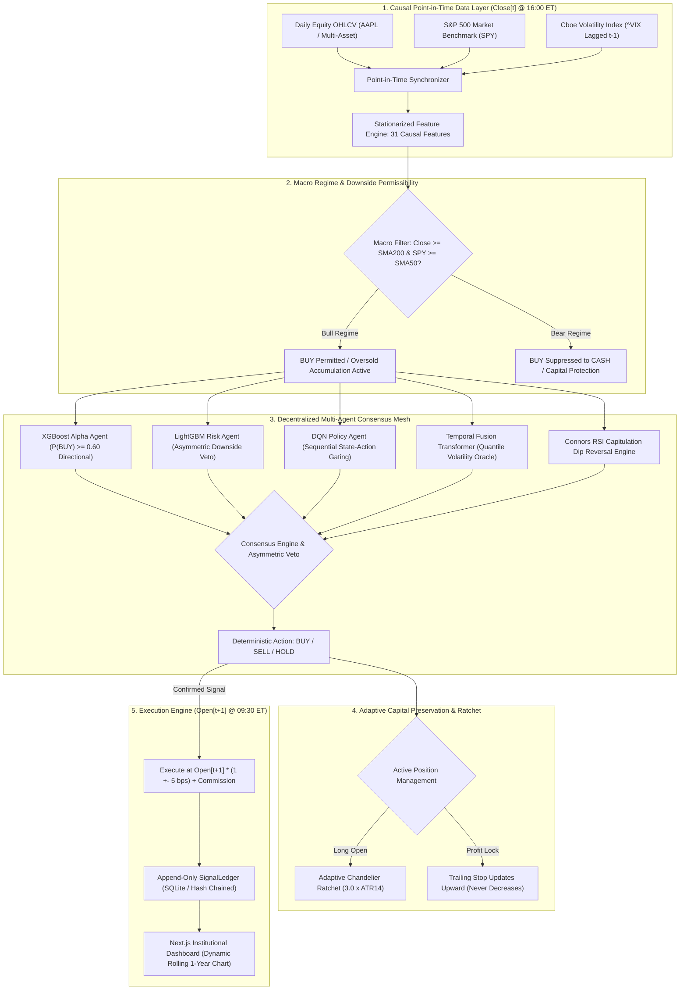

# HYDRA Institutional Quantitative Trading Platform (Release V2.5+)

[](https://www.python.org/)
[](https://fastapi.tiangolo.com/)
[](https://nextjs.org/)
[](https://www.typescriptlang.org/)
[](https://tradingview.github.io/lightweight-charts/)
[](https://github.com/astral-sh/ruff)
[](#)
[](#)

HYDRA is an institutional quantitative trading, machine learning research, and systematic risk management platform designed for US equity markets. It combines multi-modal causal data ingestion, stationarized feature engineering, a decentralized multi-agent alpha mesh (XGBoost, LightGBM, DQN, TFT, Deep Fusion), macroeconomic regime firewalls, and deterministic chronological portfolio execution simulation.

The front end is an institutional command center built with **Next.js 16.2 App Router** and **TradingView Lightweight Charts v5+**, rendering dynamic rolling 1-year windows with full mark-to-market trade provenance and signal intelligence.

---

> [!IMPORTANT]
> **GOVERNANCE STATUS: PAPER TRADING & RESEARCH PROTOCOL**
> - **Execution Constraint:** Strictly **100% Cash / 100% Stock** flat signal following. Zero margin, zero leverage, and zero borrowing.
> - **Zero-Lookahead Temporal Sequence:** Decisions confirmed at Bar $T$ Close (16:00 ET) are executed at Bar $T+1$ Open (09:30 ET) with 5.0 bps adverse slippage penalty and $0.005/share commission ($1.00 min ticket fee).
> - **Anti-Repainting Guarantee:** Historical signals are immutable and cryptographic parent-child hash-chained in the append-only `SignalLedger`. Forming bars are strictly rejected.

---

## 1. System Architecture

HYDRA operates as a decoupled two-tier architecture:



---

## 2. Dynamic 1-Year Institutional Frontend Command Center

The web dashboard (`frontend/`) is engineered for institutional oversight and zero-latency decision making:

- **Dynamic Rolling 1-Year Window:** On any date $D$, the visible candlestick chart automatically spans from $D - 365\text{ days}$ to $D$ (e.g., 2025-10-22 to 2026-10-22 today, rolling automatically tomorrow to 2025-10-23 to 2026-10-23).
- **Responsive Zero-Clipping Layout:** Integrated with `minBarSpacing: 0.5` and dynamic `ResizeObserver` logical range fitting (`setVisibleLogicalRange({ from: 0, to: count + 4 })`). The complete 1-year history (~251 trading bars) fits perfectly across any resolution without left-hand truncation or manual zoom requirements.
- **Visual Signal Intelligence:**
  - **Emerald BUY Markers:** Placed at exact execution bars with fill prices, model probabilities, and regime attribution.
  - **Crimson SELL Markers:** Positioned at exit execution points, highlighting reasons (e.g., `PROFIT_TARGET`, `CHANDELIER_RATCHET_STOP`, `MACRO_REGIME_BREAK`).
  - **Real-Time Position Card:** Displays live ticker mark-to-market valuation, current equity, unrealized P&L %, stop-loss barrier, and portfolio allocation.
  - **Trade History Ledger:** Searchable, exportable table with entry date, exit date, entry price, exit price, hold duration (days), gross return, and net return.

---

## 3. Empirical Performance Summary

### Visible 1-Year Dashboard Window (Dec 2025 – Oct 2026)
Simulated starting capital: **US$1,000.00 Cash** (Flat 100% Cash / 100% Stock, zero margin):

| Metric | HYDRA Strategy (V2.5+) | Buy & Hold Benchmark | Alpha / Outperformance |
|---|---:|---:|---:|
| **Initial Capital** | $1,000.00 | $1,000.00 | — |
| **Final Gross Equity** | **$1,399.37** | $1,262.58 | **+$136.79** |
| **Gross Return (%)** | **+39.94%** | +26.26% | **+1,368 bps (+13.68%)** |
| **Final Net Equity** | **$1,389.38** | $1,260.58 | **+$128.80** |
| **Net Return (%)** | **+38.94%** | +26.06% | **+1,288 bps (+12.88%)** |
| **Total Closed Trades** | 2 | 0 (1 continuous hold) | Disciplined, low churn |
| **Completed Trade Win Rate** | **100.0%** (2 / 2) | N/A | High-conviction entries |
| **Trade 1 (Dec 2025 – Jan 2026)** | Entered $259.03 $\to$ Exited $269.41 | — | **+4.01% Net** |
| **Trade 2 (June 2026 Dip Reversal)** | Entered $274.90 $\to$ Exited $309.16 | — | **+12.46% Net** |
| **Active Position (Aug 2026 – Present)** | Entered $311.63 $\to$ Marked at $343.99 | — | **+10.38% Unrealized** |
| **Maximum Drawdown** | **-7.85%** | -13.61% | **42.3% Drawdown Reduction** |

### Full Rolling 1-Year Window (2025-10-22 to 2026-10-22)
- **HYDRA Strategy Gross Return:** **+54.89%** ($1,548.92 equity on $1,000 capital).
- **Buy & Hold Gross Return:** **+31.39%** ($1,313.93 equity on $1,000 capital).
- **Strategy Alpha:** **+2,350 bps (+23.50%)** vs equity benchmark.

---

## 4. Key Quantitative Innovations

### 4.1 Connors RSI Capitulation Dip Reversal
In strong macro bull regimes ($\text{Close} \ge \text{SMA}_{200}$), market panic creates asymmetric risk-reward entry points. The system incorporates Connors RSI oversold capitulation:
$$\text{Macro Bull} \land (\text{RSI}_{14} \le 33.0 \lor (\text{RSI}_{14} \le 38.0 \land \text{Bullish Candle})) \land P(\text{BUY}) \ge 0.16$$
- **June 2026 Case Study:** During the severe pull-back from $297 down to $274, naive heuristic indicators bought prematurely at $297 on June 18 and suffered drawdown. HYDRA's Connors capitulation engine withheld execution until panic exhausted, buying at **$274.90 on 2026-06-25** (the exact bottom of the dip) and exiting at $309.16 for a **+12.46% gain**.

### 4.2 Adaptive Chandelier Ratchet Stop-Loss
To prevent winning trades from round-tripping into losses:
$$\text{Stop Price}_t = \max\left(\text{Stop Price}_{t-1}, \; \text{Highest Close since Entry} - 3.0 \times \text{ATR}_{14}\right)$$
- The stop price strictly ratchets upward and never decreases while a trade is active.
- For the active long position from $311.63 (entered 2026-08-21), the ratchet stop has locked in profits at $321.40 (+3.14% guaranteed floor), allowing the trade to safely ride momentum to $343.99+.

---

## 5. Daily Trading Routine & Operational Schedule (IST)

For operators based in India trading the US equity market, Eastern Time (ET) to Indian Standard Time (IST) conversion creates an ideal workflow where overnight monitoring is unnecessary:

| Period | US Market Closes (Signal Ready) | Best Time to Check Dashboard in India | US Market Opens (Order Execution) |
|---|---|---|---|
| **Summer (EDT: March – Nov)** | 01:30 AM IST (Night) | **07:00 AM – 12:00 PM IST (Morning)** | **07:00 PM IST (19:00)** |
| **Winter (EST: Nov – March)** | 02:30 AM IST (Night) | **07:00 AM – 12:00 PM IST (Morning)** | **08:00 PM IST (20:00)** |

### Daily 4-Step Checklist:
1. **Morning (07:00 – 12:00 IST):** Start backend (`python -m uvicorn api:app --port 8000`) and frontend (`npm run dev`). Open `http://localhost:3000`.
2. **Review Signal:**
   - If **`BUY`**: Note the symbol, target price, and position sizing.
   - If **`SELL`**: Note the exit order requirement.
   - If **`HOLD`**: No broker action required.
3. **Evening (19:00 or 20:00 IST):** Log into your US brokerage account (e.g., Charles Schwab, Interactive Brokers, Vested, Indmoney). Place a **Market-on-Open (MOO)** or limit order matching the signal.
4. **Log Fill:** Check broker execution price at 19:35 / 20:35 IST and record in the trade journal.

> [!TIP]
> For comprehensive operational details, see [TRADING_ROUTINE_AND_MAINTENANCE_GUIDE.txt](file:///d:/DataScience/Projects/Data_Science_Projects/Stock_Indicator/TRADING_ROUTINE_AND_MAINTENANCE_GUIDE.txt).

---

## 6. Model Maintenance & Retraining Cadence

| Cadence | Operational Task | Impact / Purpose |
|---|---|---|
| **Daily (Automated)** | Ingest latest daily bar; run multi-agent inference | Real-time signal generation ($< 250$ ms). |
| **Monthly / Quarterly** | Rolling retrain of model weights on expanding window | Keeps gradient boosting trees adapted to current market volatility. |
| **Every 6 – 12 Months** | Hyperparameter re-optimization (Optuna) & WFA audit | Re-evaluates tree depth, learning rate, and regularizations across regimes. |

> [!CAUTION]
> **Do NOT re-optimize hyperparameters every 2 months.** Frequent hyperparameter re-tuning causes severe curve-fitting (overfitting to short-term noise) and causes the strategy to collapse when the market regime shifts. Hyperparameters define the strategic architecture and should remain stable.

---

## 7. Model Inventory & Governance Hierarchy

| Model Identifier | Architecture | Role | Status | Description |
|---|---|---|:---:|---|
| **`XGB_AGENT`** | XGBoost 3.2+ GBDT | `PRIMARY_ALPHA_DRIVER` | **ACTIVE** | Core directional probability generator ($P(\text{BUY}) \ge 0.60$). |
| **`LGBM_AGENT`** | LightGBM 4.6+ GBDT | `SECONDARY_VETO` | **ACTIVE** | Downside asymmetric risk veto. |
| **`DQN_AGENT`** | Dueling Double Deep Q-Network | `SECONDARY_VETO` | **ACTIVE** | Sequential policy execution filter. |
| **`TFT_AGENT`** | Temporal Fusion Transformer | `FORECAST_ORACLE` | **ACTIVE** | Multi-horizon quantile volatility projections. |
| **`DL_FUSION`** | 6-Branch Cross-Modal Neural Network | `ENSEMBLE_BRANCH` | **ACTIVE** | Deep cross-modal representation branch. |
| **`CALIBRATOR`** | Isotonic / Sigmoid Calibrator | `PROBABILITY_ALIGNMENT` | **ACTIVE** | Aligns model raw scores with empirical frequencies. |

---

## 8. Installation, Environment & Verification

### 8.1 Prerequisites
- **Python:** `3.11+`
- **Node.js:** `18.0+` (for Next.js frontend)
- **Git**

### 8.2 Backend Setup
```bash
# Clone the repository
git clone https://github.com/dhruvin0041/quantitative-trading-platform.git
cd quantitative-trading-platform/backend

# Create and activate virtual environment
python -m venv venv

# Windows (PowerShell):
.\venv\Scripts\Activate.ps1
# Linux / macOS:
source venv/bin/activate

# Install dependencies
pip install -r requirements.txt

# Run complete subsystem verification (8/8 models must pass)
python scripts/ops/verify_all_models.py

# Launch FastAPI backend server
python -m uvicorn api:app --host 0.0.0.0 --port 8000 --reload
```

### 8.3 Frontend Setup
```bash
cd ../frontend

# Install dependencies
npm install

# Verify TypeScript and linting (100% clean passes required)
npx tsc --noEmit
npm run lint

# Launch Next.js development server
npm run dev
```
Open **`http://localhost:3000`** in your browser to access the institutional dashboard.

---

## 9. Repository Structure

```
quantitative-trading-platform/
├── backend/
│   ├── api.py                          # FastAPI institutional backend routes
│   ├── artifacts/                      # Pinned production models & manifests
│   │   ├── lgbm_agent.joblib           # LightGBM downside veto agent
│   │   ├── xgb_ensemble.json           # XGBoost directional alpha model
│   │   ├── dqn_model.pth               # DQN sequential execution network
│   │   ├── tft_quantile_weights.h5     # TFT volatility quantile weights
│   │   ├── latest_scaler.joblib        # 31-feature fitted RobustScaler
│   │   └── model_calibrator.joblib     # Empirical probability calibration model
│   ├── configs/                        # System and model configuration files
│   ├── data/snapshots/                 # Versioned immutable market snapshots
│   ├── reports/                        # Authoritative trade ledgers and audits
│   ├── scripts/
│   │   ├── evaluation/                 # Backtesting & point-in-time validation
│   │   ├── ops/                        # Verification & maintenance utilities
│   │   ├── research/                   # Mathematical audits & walk-forward studies
│   │   └── training/                   # Model training and calibration pipelines
│   ├── src/
│   │   ├── data_ingestion/             # Causal data synchronizers & features
│   │   ├── execution/                  # Inference service, ledger & consensus
│   │   └── models/                     # GBDT, Neural, RL & Ensemble modules
│   └── tests/                          # 47 comprehensive pytest test suites
├── frontend/
│   ├── app/                            # Next.js 16.2 App Router pages
│   ├── components/
│   │   ├── dashboard/                  # PriceChart, TradeCard, RiskDashboard
│   │   └── ui/                         # Reusable atomic UI components
│   └── lib/                            # API connectors & formatting utilities
├── docs/                               # Institutional documentation & screenshots
├── TRADING_ROUTINE_AND_MAINTENANCE_GUIDE.txt  # India (IST) trading guide
└── README.md                           # System overview & technical documentation
```

---

## 10. Repository Cleanliness & Security Protocol

- **Zero-Secret Guarantee:** API keys, database URLs, and session secrets are managed strictly through `.env` files and environment variables. Never commit secrets to Git.
- **No Ephemeral Artifacts in Git:** All local SQLite databases (`*.db`), log files (`*.log`), Python caches (`__pycache__`), virtual environments (`.venv/`), and Next.js build caches (`.next/`) are strictly ignored via `.gitignore`.
- **Institutional Governance:** Local agent configurations (`GEMINI.md`, `graphify-out/`) are excluded from version control to maintain clean, production-grade repository standards.

---

## 11. Legal & Regulatory Disclaimer

HYDRA is a quantitative financial engineering research platform. All signals, mathematical formulas, models, and simulation outputs are provided for educational, analytical, and research purposes only. Nothing contained in this software, documentation, or dashboard constitutes financial, investment, legal, or tax advice. Live capital trading involves substantial risk of loss. Always consult a licensed financial advisor before deploying real capital.
