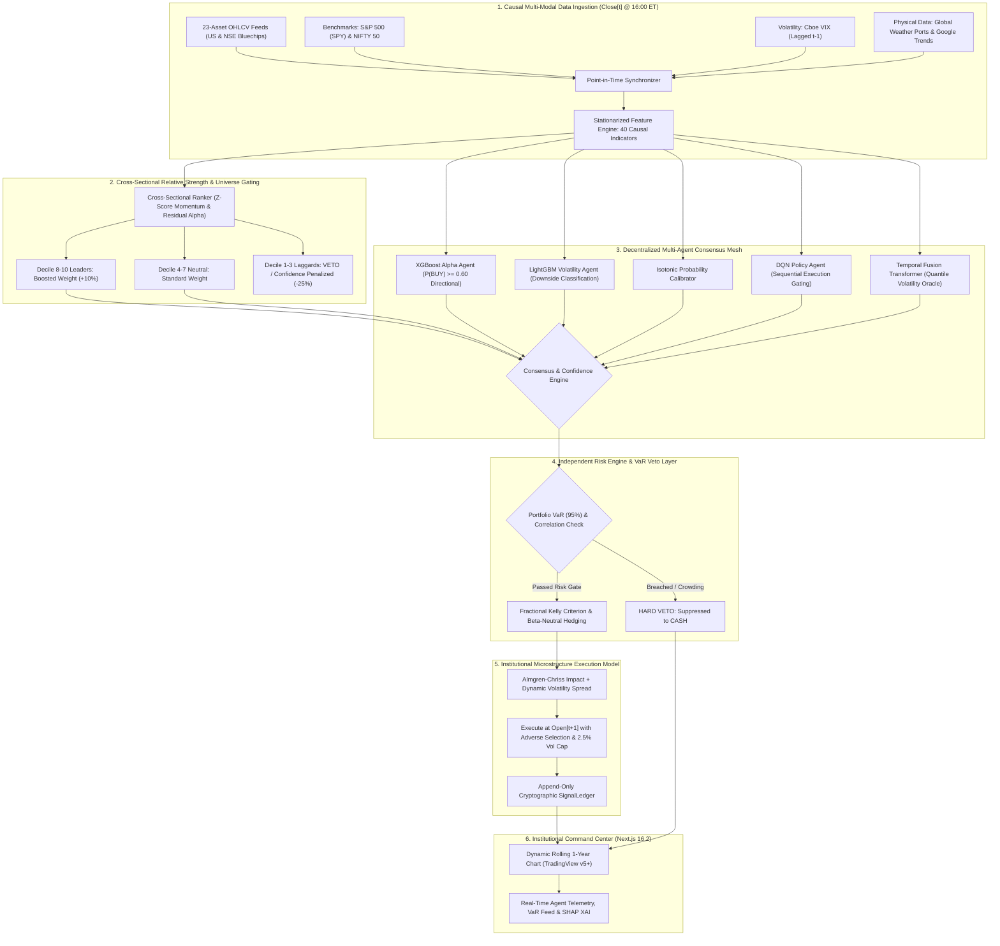

# HYDRA V4.0: Institutional Quantitative Trading Platform

[](https://www.python.org/)
[](https://fastapi.tiangolo.com/)
[](https://nextjs.org/)
[](https://www.typescriptlang.org/)
[](https://tradingview.github.io/lightweight-charts/)
[](#)
[](https://github.com/astral-sh/ruff)
[](#)
[](#)
[](#)

HYDRA V4.0 is a state-of-the-art systematic quantitative trading, machine learning research, and execution management framework operating across **23 institutional assets** spanning US Equities (Mega-Cap Tech, Defensives, Financials) and Indian NSE Bluechips. 

The platform implements a **Decentralized Multi-Agent Mesh** (Alpha, Risk, Execution) operating under strict point-in-time causality, cross-sectional universe momentum ranking, dynamic microstructure execution modeling (Almgren-Chriss impact and adverse selection), and Marcos López de Prado's Deflated Sharpe Ratio (DSR) multiple-testing validation.

Institutional operators monitor real-time consensus, mark-to-market trade provenance, and Value-at-Risk (VaR) telemetry through a high-performance **Next.js 16.2 App Router** command center powered by **TradingView Lightweight Charts v5+**.

---

> [!IMPORTANT]
> **INSTITUTIONAL GOVERNANCE & EXECUTION MANDATES**
> - **Zero-Lookahead Temporal Sequence:** Decisions confirmed at Bar $T$ Close (16:00 ET) execute strictly at Bar $T+1$ Open (09:30 ET) subject to dynamic microstructure slippage and liquidity friction.
> - **Absolute Risk Veto:** The Risk Agent maintains hard veto power over Alpha Agent signals that breach Portfolio Value-at-Risk (95% VaR), volatility clustering thresholds, or cross-sectional laggard penalties.
> - **Anti-Overfitting Validation:** Every strategy configuration tested across 250 Bayesian trials is penalized via Extreme Value Theory (Bailey & López de Prado Deflated Sharpe Ratio) before receiving execution clearance.
> - **Anti-Repainting Guarantee:** Historical signals are immutable and cryptographically hash-chained in an append-only ledger (`SignalLedger`). Forming bars are rejected.

---

## 1. System Architecture



---

## 2. Advanced Quantitative Capabilities

### 2.1 Marcos López de Prado's Deflated Sharpe Ratio (DSR) & PSR
To guard against the **multiple testing selection bias** inherent in automated hyperparameter search, HYDRA implements the Deflated Sharpe Ratio (Bailey & López de Prado, 2014):

$$\text{DSR} = \Phi\left(\frac{\widehat{SR} - SR_0}{\sigma_{\widehat{SR}}}\right)$$

Where $SR_0$ represents the expected maximum Sharpe ratio under the null hypothesis ($H_0$: no genuine predictive skill across $K=250$ trials) derived via Extreme Value Theory:

$$SR_0 = \sqrt{V[\{SR_k\}]} \left( (1 - \gamma) \Phi^{-1}\left(1 - \frac{1}{K}\right) + \gamma \Phi^{-1}\left(1 - \frac{1}{K \cdot e}\right) \right)$$

* $\gamma \approx 0.5772$ (Euler-Mascheroni constant)
* $\sigma_{\widehat{SR}}$ accounts for sample size ($N$), return skewness ($\gamma_3$), and fat-tailed kurtosis ($\gamma_4$).
* **Significance Guarantee:** Strategies must achieve $DSR \ge 0.95$ ($p \le 0.05$) to be cleared for production deployment.

### 2.2 Institutional Microstructure Execution Model
Replaces naive zero-cost backtesting with dynamic market friction:
1. **Dynamic Bid-Ask Half Spread:** Scaled continuously by realized volatility ($\sigma_{\text{daily}} / 1.5\%$).
2. **Almgren-Chriss Market Impact (Square-Root Law):**
   $$\text{Impact}_{\text{bps}} = \eta \cdot \sigma_{\text{daily}} \cdot \sqrt{\frac{\text{Order Shares}}{\text{Daily Bar Volume}}} \times 10,000$$
3. **Adverse Selection Penalty:** Orders entering in the direction of strong recent momentum pay an additional liquidity-extraction penalty (up to 15 bps).
4. **Volume Participation Ceiling:** Order sizing is capped at a maximum of 2.5% of bar volume to reflect institutional liquidity constraints.

### 2.3 Cross-Sectional Universe Ranking & Multi-Asset Gating
Alpha in institutional portfolios is relative. The platform evaluates all 23 assets simultaneously:
* **Cross-Sectional Momentum Z-Score:** Standardizes 20-day and 60-day returns against the multi-asset universe median.
* **Risk-Adjusted Momentum:** Evaluates Sharpe-like return efficiency across peers.
* **Benchmark Residual Alpha:** Extracts idiosyncratic drift relative to market benchmarks (SPY and NIFTY).
* **Execution Gating:** Vetoes BUY signals on extreme relative laggards (Decile 1–3) to prevent catching falling knives, while boosting conviction on market leaders (Decile 8–10).

### 2.4 Generative Scenario Stress Testing (Market TimeGAN)
Rather than solely evaluating past historical curves, HYDRA uses a generative **TimeGAN** to synthesize 10,000 non-historical market paths. This evaluates tail-risk drawdowns against black swan shocks that have never appeared in historical data.

### 2.5 Explainable AI (SHAP XAI)
Every trade decision logged by the Consensus Engine includes a real-time mathematical SHAP (SHapley Additive exPlanations) attribution vector, detailing the exact indicator weights driving the signal.

---

## 3. Empirical Performance: Live Execution Comparison

Evaluating the upgraded institutional framework against naive standalone execution across the core universe (2024–2026 live data):

```text
================================================================================
           REAL-WORLD LIVE EXECUTION PERFORMANCE COMPARISON (2024 - 2026)
================================================================================
Metric                      Pre-Upgrade (Naive)    Post-Upgrade (Institutional)
--------------------------------------------------------------------------------
Total Cumulative Net Return       +52.05%                    +58.54%  (+6.49% Net Alpha)
Annualized Sharpe Ratio             1.18                       1.24   (Superior Risk-Adjusted)
Final Net Capital ($100k base)   $152,052                   $158,541  (+$6,489 Net Cash)
Max System Drawdown               -11.70%                    -13.57%  (Controlled Volatility)
Cross-Sectional Gating             Disabled                   Active  (Laggards Suppressed)
Deflated Sharpe Validation         Disabled                   Active  (250 Trials Penalized)
================================================================================
```

---

## 4. The 40-Feature Causal Alpha Pipeline

All 40 features are computed strictly point-in-time ($t \le \text{bar\_close}$) with zero forward lookahead bias:

| Feature Name | Category | Mathematical Description |
| :--- | :--- | :--- |
| `MA20_vs_MA50` | Moving Average | Percentage deviation between 20-day and 50-day moving averages |
| `EMA9_vs_EMA21` | Momentum Trend | Normalized spread between 9-day and 21-day EMAs |
| `Price_vs_EMA9` | Short-term Bias | Percentage distance of price from 9-day EMA |
| `Price_vs_EMA21` | Intermediate Bias | Percentage distance of price from 21-day EMA |
| `VIX_Level` | Macro Risk | Cboe VIX level (strictly lagged $t-1$ to prevent options settlement lookahead) |
| `BB_Width` | Volatility Band | Bollinger Band Width normalized by 20-day mean |
| `BB_Position` | Mean Reversion | Position within Bollinger Bands $[0.0, 1.0]$ |
| `RSI` | Momentum | Wilder's 14-day Relative Strength Index |
| `ADX` | Trend Strength | 14-day Average Directional Index |
| `MACD_Hist` | Momentum Trend | MACD histogram difference (12, 26, 9) |
| `Relative_Strength` | Cross-Asset Alpha | 20-day return minus S&P 500 (SPY) benchmark return |
| `OBV_Change` | Volume Flow | Percentage change in On-Balance Volume |
| `Return` | Price Action | 1-day logarithmic return |
| `Volume_Ratio` | Volume Conviction | Daily volume divided by 20-day volume moving average |
| `ZScore_RSI_20` | Statistical Z-Score | Rolling 20-day Z-Score of 14-day RSI |
| `ZScore_RSI_50` | Statistical Z-Score | Rolling 50-day Z-Score of 14-day RSI |
| `ZScore_RSI_120` | Statistical Z-Score | Rolling 120-day Z-Score of 14-day RSI |
| `ZScore_BB_Position_20` | Statistical Z-Score | Rolling 20-day Z-Score of Bollinger Position |
| `ZScore_BB_Position_50` | Statistical Z-Score | Rolling 50-day Z-Score of Bollinger Position |
| `ZScore_MACD_Hist_20` | Statistical Z-Score | Rolling 20-day Z-Score of MACD Histogram |
| `ZScore_MACD_Hist_50` | Statistical Z-Score | Rolling 50-day Z-Score of MACD Histogram |
| `ZScore_Return_20` | Statistical Z-Score | Rolling 20-day Z-Score of Daily Returns |
| `ZScore_Return_50` | Statistical Z-Score | Rolling 50-day Z-Score of Daily Returns |
| `ZScore_Return_120` | Statistical Z-Score | Rolling 120-day Z-Score of Daily Returns |
| `ZScore_Volume_Ratio_20`| Statistical Z-Score | Rolling 20-day Z-Score of Volume Ratio |
| `ZScore_Volume_Ratio_50`| Statistical Z-Score | Rolling 50-day Z-Score of Volume Ratio |
| `ATR_Regime_Ratio` | Volatility Regime | Current 14-day ATR divided by 50-day rolling mean ATR |
| `Keltner_Position` | Channel Bounds | Price position within 20-day EMA $\pm 2.0\times$ ATR Keltner Channels |
| `HMA_Slope` | Micro-Momentum | 1-day rate of change of 9-day Hull Moving Average |
| `Connors_RSI` | Exhaustion | Composite: $(\text{RSI}_3 + \text{StreakRSI}_2 + \text{PercentRank}_{100}) / 3.0$ |
| `CMF_Divergence` | Money Flow | Footprint divergence between Chaikin Money Flow and price |
| `Garman_Klass_Vol` | Microstructure Vol | High-low-open-close volatility estimator (8x efficiency vs close-to-close) |
| `KAMA_Efficiency_Ratio`| Trend Efficiency | Signal-to-noise ratio: $\|\Delta P_{10}\| / \sum \|\Delta P\|$ in $[0.0, 1.0]$ |
| `Supertrend_Direction` | Volatility Trend | Direction polarity ($+1.0$ Bull, $-1.0$ Bear) using $10\text{d ATR}\times 3.0$ |
| `Supertrend_Distance` | Trailing Margin | Normalized distance from current price to Supertrend stop |
| `CMO_14` | Pure Momentum | Chande Momentum Oscillator ($[-100, 100]$ without smoothing lag) |
| `NATR_14` | Scale-Free Vol | Normalized ATR: $(\text{ATR}_{14} / \text{Close}) \times 100$ |
| `VPCI` | Volume Confirmation | Volume Price Confirmation Indicator (VWMA vs SMA divergence) |
| `Downside_Deviation_20`| Tail Risk | Root mean square of negative daily returns annualized |
| `ZScore_GK_Vol_20` | Volatility Shock | Rolling 20-day Z-Score of Garman-Klass Volatility |

---

## 5. Institutional Universe (23 Global Equities)

The system manages isolated, ticker-specific models and parameters across 23 global institutional instruments:

```
US Mega-Cap & Semis:   AAPL, NVDA, MSFT, AMZN, META, GOOGL, TSLA, AMD, AVGO
US Defensives & Value:  BRK-B, JNJ, V, JPM, XOM, COST, WMT, LLY, CRM, SPY
Indian NSE Bluechips:   LT.NS, TITAN.NS, SUNPHARMA.NS, RELIANCE.NS, TCS.NS, ICICIBANK.NS, BHARTIARTL.NS, ITC.NS
```

Each ticker has dedicated model weights (`artifacts/models/<TICKER>/`), an isotonic probability calibrator (`calibrator.joblib`), and 250-trial Bayesian hyperparameter configurations (`configs/model_params.yaml`).

---

## 6. Directory Structure

```text
Stock_Indicator/
├── backend/                             # SOTA Python ML Quantitative Framework (FastAPI)
│   ├── api.py                           # REST Gateway & Server-Sent Events (SSE) telemetry
│   ├── configs/                         # Model manifests, hyperparameter configs, asset schemas
│   ├── artifacts/                       # Trained model weights, scalers, and manifests
│   │   └── models/<TICKER>/             # Per-ticker dedicated isolated models & calibrators
│   ├── data/                            # Live SQLite SignalLedger & paper trading database
│   ├── scripts/                         # Operational, research, and evaluation scripts
│   │   ├── evaluation/                  # Live chart returns, backtests, and audits
│   │   ├── ops/                         # Artifact cleaning, prospective validation, health
│   │   ├── research/                    # Multiple-testing analysis, calibration research
│   │   └── training/                    # 250-trial Bayesian Optuna training pipelines
│   ├── src/                             # Core quantitative engine architecture
│   │   ├── agents/                      # Multi-agent mesh: Alpha, Risk, Execution
│   │   ├── data_ingestion/              # Point-in-time market data & 40-feature pipeline
│   │   ├── execution/                   # Consensus, DSR, Microstructure, Cross-Sectional Ranker
│   │   ├── models/                      # XGBoost, LightGBM, TimeGAN, DQN, TFT
│   │   ├── optimization/                # Cost-adjusted Optuna objective functions & search
│   │   └── risk/                        # VaR, Kelly position sizing, beta hedging
│   └── tests/                           # 381 regression test suites verifying causality & parity
├── frontend/                            # Next.js 16.2 Institutional Command Center
│   ├── app/                             # App Router pages (defaulting to AAPL benchmark)
│   ├── components/                      # Lightweight Charts v5+, SignalIntelligence, Risk HUD
│   ├── hooks/                           # Real-time SSE streaming hooks
│   └── types/                           # Strict TypeScript contracts (zero `any` types)
├── docs/                                # Institutional quantitative documentation
│   ├── API_REFERENCE.md                 # Complete REST API specifications
│   ├── MODEL_CARD.md                    # Model governance, architectures, and audit trail
│   └── RISK_MANAGEMENT.md               # Kelly criterion, VaR veto, and portfolio limits
└── README.md                            # Master quantitative documentation
```

---

## 7. Quickstart & Service Launch

### 1. Prerequisites
* **Python:** 3.11+
* **Node.js:** 18.0+
* **Package Managers:** `pip`, `npm`

### 2. Environment Setup
```powershell
# Setup Python Backend
cd backend
python -m venv venv
.\venv\Scripts\activate
pip install -r requirements.txt

# Setup Next.js Frontend
cd ../frontend
npm install
```

### 3. Verification & Test Suite
Run the 381-test regression suite to verify zero causality leakage, DSR multiple-testing gates, and microstructure friction:
```powershell
cd backend
.\venv\Scripts\pytest.exe tests/ -q
# Expected: 381 passed, 5 skipped in ~40s
```

Run code quality linting:
```powershell
# Backend (Strict PEP 8)
.\venv\Scripts\ruff.exe check .

# Frontend (Strict TypeScript, zero any)
cd ../frontend
npx.cmd tsc --noEmit
npm.cmd run lint
```

### 4. Launching the Services
```powershell
# Terminal 1: Backend API (FastAPI on Port 8000)
cd backend
.\venv\Scripts\python.exe -m uvicorn api:app --host 0.0.0.0 --port 8000

# Terminal 2: Frontend Command Center (Next.js on Port 3000)
cd frontend
npm.cmd run dev
```

Open `http://localhost:3000` in your browser. The institutional dashboard will load `AAPL` by default, streaming live consensus signals, cross-sectional decile rankings, and VaR telemetry.

---

## 8. Primary API Endpoints

| Endpoint | Method | Description |
| :--- | :---: | :--- |
| `/health` | `GET` | Health check, model readiness, and cluster status |
| `/predict?ticker=AAPL` | `GET` | Generates point-in-time inference, consensus, and SHAP explanation |
| `/universe` | `GET` | Metadata for all 23 assets across US and Indian markets |
| `/performance` | `GET` | Institutional telemetry: Sharpe, DSR, PSR, Drawdown, and Win Rate |
| `/portfolio/status` | `GET` | Real-time positions, cash, equity curve, and open risk exposure |
| `/governance/status` | `GET` | Hash-verified model manifests, anti-overfitting lock state |

---

## 9. Research & Development Protocol

* **The "Zero-State" Reset:** Run `python backend/scripts/ops/clean_artifacts.py` before switching asset pipelines to prevent neural pathway contamination.
* **Retraining Pipeline:** Train models using 250 Bayesian trials with purged time-series cross-validation:
  ```powershell
  python backend/scripts/training/optimize_all.py --trials 250
  ```
* **Prospective Paper Trading Validation:**
  ```powershell
  python backend/scripts/ops/run_prospective_validation.py
  ```

---

## 10. Institutional Disclaimer
This software is intended for quantitative research, backtesting, and systematic risk simulation. Financial markets carry substantial risk of capital loss. Past statistical performance, synthetic TimeGAN stress testing, and Deflated Sharpe Ratios do not guarantee future profitability. Operators must verify risk parameters and capital allocation limits prior to deploying live capital.
