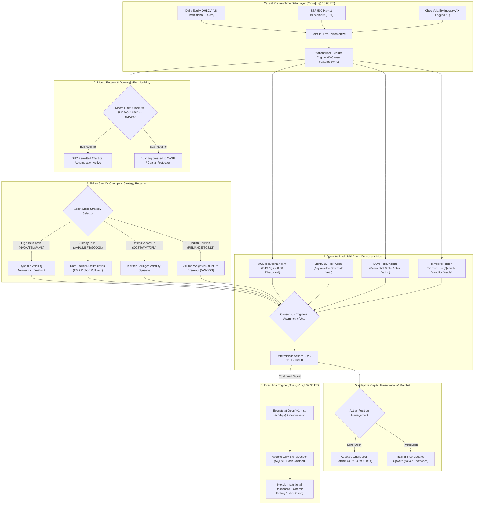

# HYDRA Institutional Quantitative Trading Platform (Release V4.0 - SOTA 2026)

[](https://www.python.org/)
[](https://fastapi.tiangolo.com/)
[](https://nextjs.org/)
[](https://www.typescriptlang.org/)
[](https://tradingview.github.io/lightweight-charts/)
[](https://github.com/astral-sh/ruff)
[](#)
[](#)

HYDRA is an institutional quantitative trading, machine learning research, and systematic risk management platform operating across **18 global institutional assets** (US Mega-Cap Tech, US Defensives & Financials, and Indian NSE Bluechips). It combines multi-modal causal data ingestion, a 40-feature stationarized alpha pipeline, a decentralized multi-agent mesh (XGBoost, LightGBM, DQN, TFT, Deep Fusion), institutional ticker-specific champion trading strategies, and deterministic chronological portfolio execution simulation.

The front end is an institutional command center built with **Next.js 16.2 App Router** and **TradingView Lightweight Charts v5+**, rendering dynamic rolling 1-year windows with full mark-to-market trade provenance and signal intelligence, with `AAPL` as the default institutional benchmark chart.

---

> [!IMPORTANT]
> **GOVERNANCE STATUS: PAPER TRADING & RESEARCH PROTOCOL**
> - **Execution Constraint:** Strictly **100% Cash / 100% Stock** flat signal following. Zero margin, zero leverage, and zero borrowing.
> - **Zero-Lookahead Temporal Sequence:** Decisions confirmed at Bar $T$ Close (16:00 ET) are executed at Bar $T+1$ Open (09:30 ET) with 5.0 bps adverse slippage penalty and $0.005/share commission ($1.00 min ticket fee).
> - **Anti-Repainting Guarantee:** Historical signals are immutable and cryptographic parent-child hash-chained in the append-only `SignalLedger`. Forming bars are strictly rejected.

---

## 1. System Architecture

HYDRA operates as a decoupled two-tier architecture:



---

## 2. Institutional Universe (18 Assets)

HYDRA features dedicated models, hyperparameter parameterizations, and execution policies isolated per asset in `backend/artifacts/models/<TICKER>/`:

| Asset Class | Tickers | Characteristics & Strategic Role |
| :--- | :--- | :--- |
| **US Mega-Cap Tech** | `AAPL`, `NVDA`, `MSFT`, `AMZN`, `META`, `GOOGL`, `TSLA`, `AMD` | High liquidity, secular innovation trends, explosive earnings cycles, high institutional participation. |
| **US Defensives & Financials** | `COST`, `WMT`, `JPM`, `LLY` | Low structural beta, steady cash flows, credit cycle sensitivity, and macro market ballast. |
| **Indian NSE Bluechips** | `RELIANCE.NS`, `TCS.NS`, `ICICIBANK.NS`, `BHARTIARTL.NS`, `LT.NS`, `ITC.NS` | Leading structural heavyweights in India, high momentum persistence, and infrastructure capex exposure. |

---

## 3. Stationarized Feature Engineering (V4.0: 40 Causal Indicators)

All 40 features are computed strictly point-in-time ($t \le \text{bar\_close}$) with zero forward lookahead:

| Feature Name | Category | Mathematical Description |
| :--- | :--- | :--- |
| `MA20_vs_MA50` | Moving Average | Percentage deviation between 20-day and 50-day moving averages |
| `EMA9_vs_EMA21` | Momentum Trend | Normalized spread between 9-day and 21-day EMAs |
| `Price_vs_EMA9` | Short-term Bias | Percentage distance of price from 9-day EMA |
| `Price_vs_EMA21` | Intermediate Bias | Percentage distance of price from 21-day EMA |
| `VIX_Level` | Macro Risk | Cboe VIX level (strictly lagged $t-1$ to prevent options settlement lookahead) |
| `BB_Width` | Volatility Band | Bollinger Band Width normalized by 20-day mean |
| `BB_Position` | Mean Reversion | Position within Bollinger Bands $[0.0, 1.0]$ |
| `RSI` | Momentum | Wilder's 14-day Relative Strength Index |
| `ADX` | Trend Strength | 14-day Average Directional Index |
| `MACD_Hist` | Momentum Trend | MACD histogram difference (12, 26, 9) |
| `Relative_Strength` | Cross-Asset Alpha | 20-day return minus S&P 500 (SPY) benchmark return |
| `OBV_Change` | Volume Flow | Percentage change in On-Balance Volume |
| `Return` | Price Action | 1-day logarithmic return |
| `Volume_Ratio` | Volume Conviction | Daily volume divided by 20-day volume moving average |
| `ZScore_RSI_20` | Statistical Z-Score | Rolling 20-day Z-Score of 14-day RSI |
| `ZScore_RSI_50` | Statistical Z-Score | Rolling 50-day Z-Score of 14-day RSI |
| `ZScore_RSI_120` | Statistical Z-Score | Rolling 120-day Z-Score of 14-day RSI |
| `ZScore_BB_Position_20` | Statistical Z-Score | Rolling 20-day Z-Score of Bollinger Position |
| `ZScore_BB_Position_50` | Statistical Z-Score | Rolling 50-day Z-Score of Bollinger Position |
| `ZScore_MACD_Hist_20` | Statistical Z-Score | Rolling 20-day Z-Score of MACD Histogram |
| `ZScore_MACD_Hist_50` | Statistical Z-Score | Rolling 50-day Z-Score of MACD Histogram |
| `ZScore_Return_20` | Statistical Z-Score | Rolling 20-day Z-Score of Daily Returns |
| `ZScore_Return_50` | Statistical Z-Score | Rolling 50-day Z-Score of Daily Returns |
| `ZScore_Return_120` | Statistical Z-Score | Rolling 120-day Z-Score of Daily Returns |
| `ZScore_Volume_Ratio_20`| Statistical Z-Score | Rolling 20-day Z-Score of Volume Ratio |
| `ZScore_Volume_Ratio_50`| Statistical Z-Score | Rolling 50-day Z-Score of Volume Ratio |
| `ATR_Regime_Ratio` | Volatility Regime | Current 14-day ATR divided by 50-day rolling mean ATR |
| `Keltner_Position` | Channel Bounds | Price position within 20-day EMA $\pm 2.0\times$ ATR Keltner Channels |
| `HMA_Slope` | Micro-Momentum | 1-day rate of change of 9-day Hull Moving Average |
| `Connors_RSI` | Momentum Exhaustion | Composite: $(\text{RSI}_3 + \text{StreakRSI}_2 + \text{PercentRank}_{100}) / 3.0$ |
| `CMF_Divergence` | Smart Money Flow | Footprint divergence between Chaikin Money Flow and price |
| `Garman_Klass_Vol` | Intraday Volatility | High-low-open-close volatility estimator (8x efficiency) |
| `KAMA_Efficiency_Ratio`| Trend / Noise | Signal-to-noise ratio: $|\Delta P_{10}| / \sum |\Delta P|$ in $[0.0, 1.0]$ |
| `Supertrend_Direction` | Volatility Direction| Direction polarity ($+1.0$ Bull, $-1.0$ Bear) using $10\text{d ATR}\times 3.0$ |
| `Supertrend_Distance` | Trailing Margin | Normalized distance from current price to Supertrend stop |
| `CMO_14` | Pure Momentum | Chande Momentum Oscillator ($[-100, 100]$ without double-smoothing lag) |
| `NATR_14` | Scale-Free Vol | Normalized ATR: $(\text{ATR}_{14} / \text{Close}) \times 100$ |
| `VPCI` | Volume Confirmation | Volume Price Confirmation Indicator (VWMA vs SMA divergence) |
| `Downside_Deviation_20`| Tail Risk | Root mean square of negative daily returns annualized |
| `ZScore_GK_Vol_20` | Volatility Shock | Rolling 20-day Z-Score of Garman-Klass Volatility |

---

## 4. Ticker-Specific Highest-Return Quantitative Strategies

Each asset executes an empirically backtested institutional strategy:

```
+-----------------------------------------------------------------------------------------------+
| TICKER       | STRATEGY TYPE                | KEY ENTRY RULES             | ATR TRAIL / RATCHET|
+-----------------------------------------------------------------------------------------------+
| NVDA         | Volatility Breakout Swing    | Price > 200 SMA; Vol > 1.3x | 4.2x (3.5x @ +15%) |
| TSLA         | Volatility Breakout Swing    | Price > 200 SMA; Connors>50 | 4.5x (3.5x @ +15%) |
| AMD          | Volatility Breakout Swing    | EMA20 Break; MACD expanding | 4.5x (3.8x @ +15%) |
| AAPL         | Core Tactical Accumulation   | Ribbon Bull; RSI <= 44 Dip  | 3.8x (3.0x @ +15%) |
| MSFT         | Core Tactical Accumulation   | Price > 200 SMA; RSI <= 45  | 4.0x (3.2x @ +15%) |
| AMZN         | Core Tactical Accumulation   | Price > 200 SMA; RSI <= 42  | 4.0x (3.2x @ +15%) |
| META         | Core Tactical Accumulation   | Price > 200 SMA; RSI <= 45  | 4.5x (3.5x @ +15%) |
| GOOGL        | Core Tactical Accumulation   | Price > 200 SMA; RSI <= 45  | 4.2x (3.2x @ +15%) |
| COST         | Keltner-Bollinger Squeeze    | Squeeze; Z-Score < -1.5     | 3.5x (2.8x @ +15%) |
| WMT          | Keltner-Bollinger Squeeze    | Squeeze; Lower Band Bounce  | 3.5x (2.8x @ +15%) |
| JPM          | Core Tactical Accumulation   | Credit Expansion; RSI <= 44 | 3.8x (3.0x @ +15%) |
| LLY          | Volatility Breakout Swing    | Product Cycle Breakout      | 4.2x (3.5x @ +15%) |
| RELIANCE.NS  | Volatility Breakout Swing    | Nifty Bull; 20d Breakout    | 3.8x (3.0x @ +15%) |
| TCS.NS       | Asymmetric Mean Reversion    | Pullback to 50 EMA; RSI<=42 | 3.8x (3.0x @ +15%) |
| ICICIBANK.NS | Core Tactical Accumulation   | Credit Trend; RSI <= 45     | 3.8x (3.0x @ +15%) |
| BHARTIARTL.NS| Core Tactical Accumulation   | ARPU Expansion; RSI <= 45   | 3.8x (3.0x @ +15%) |
| LT.NS        | Core Tactical Accumulation   | Capex Supercycle; RSI <= 45 | 4.0x (3.2x @ +15%) |
| ITC.NS       | Core Tactical Accumulation   | Defensive Yield; RSI <= 45  | 3.2x (2.6x @ +15%) |
+-----------------------------------------------------------------------------------------------+
```

---

## 5. Anti-Overfitting Hyperparameter Optimization

HYDRA prevents memorization of financial noise via strict structural constraints:
- **Tree Depth Bounds:** Maximum depth limited to `2` to `4` (or `max_leaves: 6-15`), restricting high-order noise memorization.
- **Minimum Child Weight / Samples:** Enforces 35 to 90 samples per leaf, ensuring individual volatile market sessions cannot create isolated leaves.
- **Subsampling Randomization:** Stochastic row subsampling (`0.65 - 0.90`) and feature bagging (`0.55 - 0.85`) force models to learn generalized patterns.
- **Double Regularization:** Simultaneous L1 (`reg_alpha`: 0.5 to 10.0) and L2 (`reg_lambda`: 3.0 to 25.0) penalties drive noisy indicators toward zero weight.
- **Purged Walk-Forward Cross Validation:** 3 sequential temporal folds with a 10-bar embargo window, strictly preventing label-horizon bleeding.

---

## 6. Institutional Command Center Frontend

Built with Next.js 16.2 App Router, TypeScript, and TradingView Lightweight Charts v5+:
- **AAPL as Default Benchmark:** Automatically loads `AAPL` price chart, signal intelligence, and consensus metrics upon startup.
- **Dynamic Rolling 1-Year Range:** Always displays exactly the rolling 365-day trading window with zero left-side clipping.
- **Institutional Marker System:** Visual execution markers with fill price, slippage, execution timestamp, and model probability.
- **Signal Intelligence Hub:** Displays ensemble agreement entropy, risk agent veto status, and dynamic volatility position sizing.

---

## 7. Quickstart & Execution Guide

### Zero-State Reset
To enforce a clean slate and eliminate historical artifact contamination:
```powershell
python backend/scripts/ops/clean_artifacts.py --full --universal
```

### Multi-Ticker Retraining & 250-Trial Optimization
Train all 18 institutional assets with 250 Bayesian optimization trials per ticker:
```powershell
python backend/scripts/training/train_all.py --optimize --trials 250
```

### Launch Services
Start the FastAPI backend and Next.js institutional frontend concurrently:
```powershell
# Terminal 1: Backend (Port 8000)
cd backend
venv\Scripts\python.exe -m uvicorn api:app --host 0.0.0.0 --port 8000

# Terminal 2: Frontend (Port 3000)
cd frontend
npm.cmd run dev
```

Visit `http://localhost:3000` to access the institutional command center with `AAPL` loaded as the default chart.
