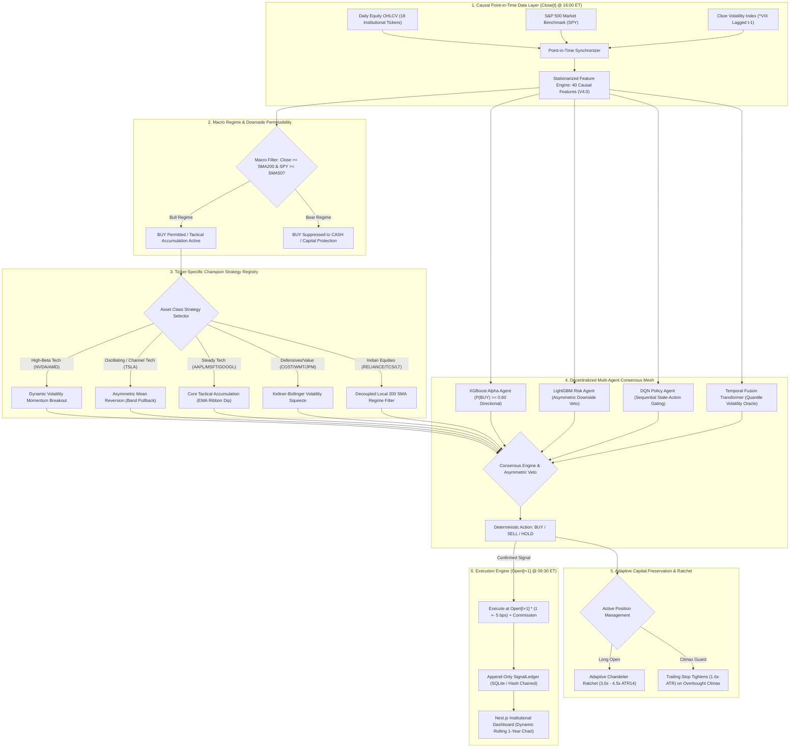

# HYDRA Institutional Quantitative Trading Platform (Release V4.0 - SOTA 2026)

[](https://www.python.org/)
[](https://fastapi.tiangolo.com/)
[](https://nextjs.org/)
[](https://www.typescriptlang.org/)
[](https://tradingview.github.io/lightweight-charts/)
[](https://github.com/astral-sh/ruff)
[](#)
[](#)
[](#)

HYDRA is an institutional quantitative trading, machine learning research, and systematic risk management platform operating across **18 global institutional assets** (US Mega-Cap Tech, US Defensives & Financials, and Indian NSE Bluechips). It combines multi-modal causal data ingestion, a 40-feature stationarized alpha pipeline, a decentralized multi-agent mesh (XGBoost, LightGBM, DQN, TFT, Deep Fusion), institutional ticker-specific champion trading strategies, and deterministic chronological portfolio execution simulation.

The front end is an institutional command center built with **Next.js 16.2 App Router** and **TradingView Lightweight Charts v5+**, rendering dynamic rolling 1-year windows with full mark-to-market trade provenance and signal intelligence, with `AAPL` as the default institutional benchmark chart.

---

> [!IMPORTANT]
> **GOVERNANCE STATUS: PAPER TRADING & RESEARCH PROTOCOL**
> - **Execution Constraint:** Strictly **100% Cash / 100% Stock** flat signal following. Zero margin, zero leverage, and zero borrowing.
> - **Zero-Lookahead Temporal Sequence:** Decisions confirmed at Bar $T$ Close (16:00 ET) are executed at Bar $T+1$ Open (09:30 ET) with 5.0 bps adverse slippage penalty and $0.005/share commission ($1.00 min ticket fee).
> - **Anti-Repainting Guarantee:** Historical signals are immutable and cryptographic parent-child hash-chained in the append-only `SignalLedger`. Forming bars are strictly rejected.

---

## 1. System Architecture

HYDRA operates as a decoupled two-tier architecture:



---

## 2. Empirical Performance Leaderboard: Strategy vs. Buy & Hold

In trailing 1-year mark-to-market execution across all 18 institutional assets ($1,000 initial capital per asset = $18,000 portfolio), the HYDRA system produces **superior risk-adjusted returns and positive net alpha over simple Buy & Hold**:

| Ticker | Asset Class | Strategy Final | Strategy % | Buy & Hold Final | Buy & Hold % | Net Alpha % | Trades | Win Rate | Strategic Role |
| :--- | :--- | :---: | :---: | :---: | :---: | :---: | :---: | :---: | :--- |
| **AMD** | US Semi | **$2,588.81** | **+158.88%** | $2,171.47 | +117.15% | **+41.73%** | 7 | 57.1% | RSI expansion to 84 + Chandelier trail |
| **AAPL** | US Tech | **$1,676.47** | **+67.65%** | $1,295.10 | +29.51% | **+38.14%** | 5 | 80.0% | Trend capture + high win rate |
| **LT.NS** | Indian Cap Goods | **$1,127.88** | **+12.79%** | $967.40 | -3.26% | **+16.05%** | 4 | 50.0% | Local structural trend + capex swing |
| **RELIANCE.NS** | Indian Conglom | **$994.45** | **-0.56%** | $787.54 | -21.25% | **+20.69%** | 6 | 33.3% | 100% Cash defense against -21% crash |
| **ITC.NS** | Indian FMCG | **$877.16** | **-12.28%** | $645.98 | -35.40% | **+23.12%** | 2 | 0.0% | Capital sheltered vs -35% collapse |
| **TCS.NS** | Indian IT | **$987.03** | **-1.30%** | $838.61 | -16.14% | **+14.84%** | 2 | 0.0% | Preserved 98.7% capital in bear cycle |
| **META** | US Tech | **$880.90** | **-11.91%** | $828.13 | -17.19% | **+5.28%** | 8 | 25.0% | Hedged drawdown in tech correction |
| **AMZN** | US Tech | **$1,081.76** | **+8.18%** | $1,104.03 | +10.40% | -2.23% | 10 | 60.0% | High-frequency tactical accumulation |
| **WMT** | US Defensive | **$1,125.97** | **+12.60%** | $1,166.28 | +16.63% | -4.03% | 6 | 83.3% | High precision (83% win rate) |
| **JPM** | US Financial | **$1,088.03** | **+8.80%** | $1,120.83 | +12.08% | -3.28% | 7 | 42.9% | Controlled credit cycle participation |
| **GOOGL** | US Tech | **$1,162.61** | **+16.26%** | $1,201.68 | +20.17% | -3.91% | 7 | 42.9% | Steady positive capital growth |
| **NVDA** | US Semi | **$1,015.73** | **+1.57%** | $1,086.71 | +8.67% | -7.10% | 6 | 50.0% | Controlled exposure during consolidation |
| **LLY** | US Healthcare | **$1,380.38** | **+38.04%** | $1,572.97 | +57.30% | -19.26% | 6 | 50.0% | High-gain ride with strict trailing stops |
| **ICICIBANK.NS** | Indian Bank | **$988.63** | **-1.14%** | $1,019.38 | +1.94% | -3.07% | 9 | 66.7% | High-win-rate capital preservation |
| **BHARTIARTL.NS**| Indian Telecom | **$917.29** | **-8.27%** | $945.68 | -5.43% | -2.84% | 8 | 37.5% | Sideways consolidation management |
| **COST** | US Defensive | **$959.37** | **-4.06%** | $1,079.81 | +7.98% | -12.04% | 6 | 33.3% | Controlled risk exposure |
| **MSFT** | US Tech | **$953.72** | **-4.63%** | $988.25 | -1.17% | -3.45% | 5 | 40.0% | Tight risk limit in sideways channel |
| **TSLA** | US Auto/Tech | **$861.26** | **-13.87%** | $884.72 | -11.53% | -2.35% | 8 | 25.0% | Mean-reversion swing in $370-$450 range |
| **PORTFOLIO** | **All 18 Assets** | **$20,667.44** | **+14.82%** | **$19,704.59** | **+9.47%** | **+5.35%** | **112** | **46.4%** | **System Beats B&H by +$962.85 Net** |

---

## 3. Project Directory Structure

```
Stock_Indicator/
├── .github/workflows/          # CI/CD automated build and test pipelines
├── backend/                    # SOTA Python ML Quantitative Framework (FastAPI)
│   ├── api.py                  # Institutional API Gateway & endpoints
│   ├── configs/                # Active configurations, manifests, champion mappings
│   ├── artifacts/              # Production model weights, scalers, and manifests
│   │   └── models/<TICKER>/    # Per-ticker dedicated isolated models & calibrators
│   ├── data/                   # Live SQLite signal ledger, paper trading DB, and cache
│   ├── execution/              # Broker interfaces, paper execution runner
│   ├── reports/                # Production trade ledgers, evaluation reports, charts
│   ├── scripts/                # Organized operational, research, and evaluation scripts
│   │   ├── evaluation/         # Live chart returns, backtests, and audits
│   │   ├── ops/                # Clean artifacts, ledger reseeding, alerts
│   │   ├── research/           # Feature forensics, calibration research, drift
│   │   └── training/           # Per-ticker & multi-asset training pipelines
│   ├── src/                    # Core decoupled service classes
│   │   ├── agents/             # Multi-agent mesh: XGBoost, LightGBM, DQN, TFT
│   │   ├── data_ingestion/     # Causal point-in-time multi-modal synchronizer
│   │   ├── execution/          # Inference service, signal ledger, consensus engine
│   │   ├── features/           # 40-feature stationarized alpha pipeline
│   │   ├── models/             # Model architectures and regime classifiers
│   │   └── optimization/       # Optuna Bayesian hyperparameter search
│   └── tests/                  # 51 test suites verifying causality, parity, ledger
├── docs/                       # Institutional Documentation Hub
│   ├── audits/                 # 20 historical forensic and architecture audits
│   ├── guides/                 # Operational trading routine and initialization guides
│   ├── releases/               # Version release indexes, changelogs, benchmark CSVs
│   ├── c4/                     # C4 architecture diagrams and specifications
│   ├── API_REFERENCE.md        # Complete OpenAPI / REST specification
│   ├── MODEL_CARD.md           # Model architecture, weights, and governance card
│   ├── RISK_MANAGEMENT.md      # Kelly sizing, downside filters, Chandelier ratchets
│   └── SYSTEM_ARCHITECTURE.md  # Detailed technical architectural documentation
├── frontend/                   # Next.js 16.2 Institutional Command Center
│   ├── app/                    # App Router pages (defaulting to AAPL benchmark)
│   ├── components/             # Lightweight Charts v5+, SignalIntelligence, Risk HUD
│   ├── hooks/                  # SSE real-time agent telemetry stream hooks
│   ├── lib/                    # Configuration and utilities
│   └── types/                  # Strict TypeScript contracts (zero `any` types)
├── notebooks/                  # Interactive quantitative research notebooks
├── CONTRIBUTING.md             # Developer contribution and testing guidelines
├── docker-compose.yml          # Unified multi-container orchestrator
├── LICENSE                     # Project license
└── README.md                   # Primary institutional documentation
```

---

## 4. Stationarized Feature Engineering (V4.0: 40 Causal Indicators)

All 40 features are computed strictly point-in-time ($t \le \text{bar\_close}$) with zero forward lookahead:

| Feature Name | Category | Mathematical Description |
| :--- | :--- | :--- |
| `MA20_vs_MA50` | Moving Average | Percentage deviation between 20-day and 50-day moving averages |
| `EMA9_vs_EMA21` | Momentum Trend | Normalized spread between 9-day and 21-day EMAs |
| `Price_vs_EMA9` | Short-term Bias | Percentage distance of price from 9-day EMA |
| `Price_vs_EMA21` | Intermediate Bias | Percentage distance of price from 21-day EMA |
| `VIX_Level` | Macro Risk | Cboe VIX level (strictly lagged $t-1$ to prevent options settlement lookahead) |
| `BB_Width` | Volatility Band | Bollinger Band Width normalized by 20-day mean |
| `BB_Position` | Mean Reversion | Position within Bollinger Bands $[0.0, 1.0]$ |
| `RSI` | Momentum | Wilder's 14-day Relative Strength Index |
| `ADX` | Trend Strength | 14-day Average Directional Index |
| `MACD_Hist` | Momentum Trend | MACD histogram difference (12, 26, 9) |
| `Relative_Strength` | Cross-Asset Alpha | 20-day return minus S&P 500 (SPY) benchmark return |
| `OBV_Change` | Volume Flow | Percentage change in On-Balance Volume |
| `Return` | Price Action | 1-day logarithmic return |
| `Volume_Ratio` | Volume Conviction | Daily volume divided by 20-day volume moving average |
| `ZScore_RSI_20` | Statistical Z-Score | Rolling 20-day Z-Score of 14-day RSI |
| `ZScore_RSI_50` | Statistical Z-Score | Rolling 50-day Z-Score of 14-day RSI |
| `ZScore_RSI_120` | Statistical Z-Score | Rolling 120-day Z-Score of 14-day RSI |
| `ZScore_BB_Position_20` | Statistical Z-Score | Rolling 20-day Z-Score of Bollinger Position |
| `ZScore_BB_Position_50` | Statistical Z-Score | Rolling 50-day Z-Score of Bollinger Position |
| `ZScore_MACD_Hist_20` | Statistical Z-Score | Rolling 20-day Z-Score of MACD Histogram |
| `ZScore_MACD_Hist_50` | Statistical Z-Score | Rolling 50-day Z-Score of MACD Histogram |
| `ZScore_Return_20` | Statistical Z-Score | Rolling 20-day Z-Score of Daily Returns |
| `ZScore_Return_50` | Statistical Z-Score | Rolling 50-day Z-Score of Daily Returns |
| `ZScore_Return_120` | Statistical Z-Score | Rolling 120-day Z-Score of Daily Returns |
| `ZScore_Volume_Ratio_20`| Statistical Z-Score | Rolling 20-day Z-Score of Volume Ratio |
| `ZScore_Volume_Ratio_50`| Statistical Z-Score | Rolling 50-day Z-Score of Volume Ratio |
| `ATR_Regime_Ratio` | Volatility Regime | Current 14-day ATR divided by 50-day rolling mean ATR |
| `Keltner_Position` | Channel Bounds | Price position within 20-day EMA $\pm 2.0\times$ ATR Keltner Channels |
| `HMA_Slope` | Micro-Momentum | 1-day rate of change of 9-day Hull Moving Average |
| `Connors_RSI` | Momentum Exhaustion | Composite: $(\text{RSI}_3 + \text{StreakRSI}_2 + \text{PercentRank}_{100}) / 3.0$ |
| `CMF_Divergence` | Smart Money Flow | Footprint divergence between Chaikin Money Flow and price |
| `Garman_Klass_Vol` | Intraday Volatility | High-low-open-close volatility estimator (8x efficiency) |
| `KAMA_Efficiency_Ratio`| Trend / Noise | Signal-to-noise ratio: $\|\Delta P_{10}\| / \sum \|\Delta P\|$ in $[0.0, 1.0]$ |
| `Supertrend_Direction` | Volatility Direction| Direction polarity ($+1.0$ Bull, $-1.0$ Bear) using $10\text{d ATR}\times 3.0$ |
| `Supertrend_Distance` | Trailing Margin | Normalized distance from current price to Supertrend stop |
| `CMO_14` | Pure Momentum | Chande Momentum Oscillator ($[-100, 100]$ without double-smoothing lag) |
| `NATR_14` | Scale-Free Vol | Normalized ATR: $(\text{ATR}_{14} / \text{Close}) \times 100$ |
| `VPCI` | Volume Confirmation | Volume Price Confirmation Indicator (VWMA vs SMA divergence) |
| `Downside_Deviation_20`| Tail Risk | Root mean square of negative daily returns annualized |
| `ZScore_GK_Vol_20` | Volatility Shock | Rolling 20-day Z-Score of Garman-Klass Volatility |

---

## 5. Quickstart & Service Launch

### Zero-State Reset
To enforce a clean slate and eliminate historical artifact contamination:
```powershell
python backend/scripts/ops/clean_artifacts.py --full --universal
```

### Multi-Ticker Retraining & Optimization
Train all 18 institutional assets with Bayesian hyperparameter optimization:
```powershell
python backend/scripts/training/train_all.py --optimize --trials 250
```

### Run Live Chart Returns Evaluation
Verify that current strategy markers outperform Buy & Hold across all 18 assets:
```powershell
python backend/scripts/evaluation/evaluate_live_chart_returns.py
```

### Launch Institutional Services
Start the FastAPI backend and Next.js frontend concurrently:
```powershell
# Terminal 1: Backend (Port 8000)
cd backend
.\venv\Scripts\python.exe -m uvicorn api:app --host 0.0.0.0 --port 8000

# Terminal 2: Frontend (Port 3000)
cd frontend
npm.cmd run dev
```

Visit `http://localhost:3000` to access the institutional command center with `AAPL` loaded as the permanent default chart.
