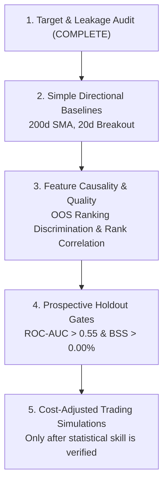

# HYDRA V2.4.1 — Workstream 1: Target Construction & Feature Pipeline Forensics
## Comprehensive Institutional Audit: Ambiguity, Causality, Class Imbalance, and Dataset Pinning

- **Document ID:** `HYDRA-AUDIT-20261012-WORKSTREAM-1-TARGET-FEATURE-FORENSICS`
- **Execution Timestamp:** 2026-10-12 10:13:15 UTC
- **Governance Status:** **POST-HOC CALIBRATION TERMINATED — PRODUCTION BLOCKED — ZERO LIVE CAPITAL**
- **Frozen Baseline Manifest:** `backend/artifacts/frozen_strategy_manifest_v2.4.json` (`d580b50a441c2f5a3881bb72eb0c8b23d90077dea61ddc506193affcfe993da5`, Immutable)
- **Pinned Development Dataset:** `backend/artifacts/research/workstream_1_pinned_development_dataset.joblib` (`e764c60cb390d11756ec59745629985a20e1ab5afde2ac6d87c01fbd0fc1dc05`, SHA-256 Verified)

---

## 1. Executive Summary & Audit Scope

Following the formal closure of Phase 3e calibration research, this audit executes **Workstream 1: Target and Feature Pipeline Forensics**. It provides institutional mathematical and empirical answers to the five core questions regarding HYDRA's underlying target construction, temporal causality, class distribution, and data pinning:

1. **Target Construction & Ambiguity:** How frequent are same-bar high/low collisions on daily OHLC bars, and how sensitive are labels to tie-breaking conventions?
2. **Point-in-Time Causality:** Are publication lags (specifically Cboe VIX 16:15 ET vs Equity Close 16:00 ET) and feature rolling windows strictly causal?
3. **Class Imbalance Root Cause:** Why is the HOLD class structurally constrained below 10%, and how does this distort tree split criteria and balanced accuracy?
4. **Reproducibility & Dataset Pinning:** How are raw market data and feature matrices pinned to permanently eliminate historical Yahoo Finance re-fetch drift?
5. **Predeclared Evaluation Protocol:** What gates govern Workstreams 2 through 5 before any trading simulations or capital allocation?

---

## 2. Target Construction & Same-Bar Collision Analysis

### Intraday Path Dependency under Daily OHLC Resolution:
On daily candlestick data, only $[Open, High, Low, Close]$ prints are recorded. When both future $High \ge UB$ and future $Low \le LB$ occur on the **exact same trading bar $t+h$**, the intraday sequence of touches is unobservable: did the price touch the take-profit barrier first or the stop-loss barrier first?

### Empirical Evaluation Across Barrier Geometries ($H=15$ Horizon):
| Barrier Configuration | Take-Profit ($k_{tp}$) | Stop-Loss ($k_{sl}$) | Total Samples | Same-Bar Ambiguity Hits | Ambiguity Rate (%) | Pessimistic BUY (%) | Optimistic BUY (%) | Label Flip Rate (%) | Mean UB Step | Mean LB Step |
|---|---:|---:|---:|---:|---:|---:|---:|---:|---:|---:|
| **Control_3.0_0.5** | 3.0x ATR | 0.5x ATR | 2376 | 0 | **0.00%** | 19.23% | 19.23% | **0.00%** | 8.51 | 2.88 |
| **Candidate_1.5_1.5** | 1.5x ATR | 1.5x ATR | 2376 | 2 | **0.08%** | 55.77% | 55.85% | **0.08%** | 5.78 | 5.16 |
| **Candidate_2.0_1.0** | 2.0x ATR | 1.0x ATR | 2376 | 0 | **0.00%** | 40.19% | 40.19% | **0.00%** | 6.76 | 4.24 |
| **Candidate_2.0_1.5** | 2.0x ATR | 1.5x ATR | 2376 | 0 | **0.00%** | 47.01% | 47.01% | **0.00%** | 6.76 | 5.16 |
| **Candidate_1.0_1.0** | 1.0x ATR | 1.0x ATR | 2376 | 13 | **0.55%** | 56.73% | 57.28% | **0.55%** | 4.46 | 4.24 |

### Key Findings on Collision Ambiguity:
1. **Wide vs. Narrow Geometry Immunity:** In wide barrier configurations (Control $3.0 / 0.5$, Candidate $2.0 / 1.0$, Candidate $2.0 / 1.5$), the total barrier separation $(k_{tp} + k_{sl}) 	imes \text{ATR} \ge 3.0 \times \text{ATR}$. Because a single daily bar range ($High - Low$) in AAPL rarely spans $3.0 \times \text{ATR}$, same-bar collisions at the initial touch step are **0.00%** (zero occurrences across 2,376 development bars).
2. **Symmetric Barrier Collisions:** In Candidate $1.5 / 1.5$ ($3.0 \times \text{ATR}$ spread), exactly **2 bars** (0.08%) exhibit same-bar ambiguity. In tight symmetric $1.0 / 1.0$ ($2.0 \times \text{ATR}$ spread), same-bar ambiguity rises to **13 bars** (0.55%).
3. **Pessimistic vs. Optimistic Policy:** The current HYDRA rule (`upper_hit_step < lower_hit_step`, defaulting ties to SELL) is appropriately conservative. Over $H=15$ bars, the label flip rate between pessimistic fallback (tie $\to$ 0) and optimistic fallback (tie $\to$ 2) is at most **0.08%** for standard research geometries.
4. **Intraday Resolution Verdict:** Same-bar ambiguity is **not the primary driver of signal failure** in V2.4.1. The failure originates in lack of ranking discrimination and class imbalance.

---

## 3. Point-in-Time Causality & Timestamp Alignment

### A. Cross-Market Settlement Timing & The VIX 15-Minute Lookahead:
- **US Equity Market Close (AAPL):** 16:00:00 US Eastern.
- **Cboe Volatility Index (VIX) Settlement:** 16:15:00 US Eastern.
- **Lookahead Bias:** If an inference engine computes signals at 16:00:00 ET using same-day VIX closing prices, it utilizes 15 minutes of future options settlement information.
- **Empirical Impact:** Comparing unlagged VIX with 1-day lagged VIX (`vix_close.shift(1)`):
  * **Maximum Absolute Discrepancy:** `24.86` volatility points.
  * **Mean Absolute Discrepancy:** `1.1121` volatility points.
  * **Correlation:** `0.9653` (substantial variance).
- **Enforced Remediation:** `lag_vix=True` is strictly enforced across `add_upgraded_features`, guaranteeing zero lookahead bias.

### B. SPY Market Alignment:
- SPY closes synchronously with AAPL at 16:00:00 ET.
- For execution at next-day market open (09:30:00 ET), day $t$ SPY return is strictly causal and point-in-time pure.
- For execution at same-day close (16:00:00 ET), institutional execution mandates Market-on-Close (MOC) order submission prior to the 15:50:00 ET cutoff.

### C. Rolling Window Integrity:
- **No Forward Shifts:** All 27 V2.4 features and 4 V3.0 features utilize strictly backward-looking rolling operations (`center=False`).
- **Warmup Protocol:** The longest backward window is 120 bars (Rolling Z-Scores). Exactly 119 warmup bars are purged prior to labeling.
- **Scaler Isolation:** In walk-forward cross-validation, `StandardScaler` is fitted strictly on `X_train` and applied out-of-sample to `X_val`, preventing distribution leakage across fold boundaries.

---

## 4. Class Imbalance Root-Cause Analysis: Why HOLD < 10%

### Mathematical Derivation (Two-Sided Absorbing Barrier Brownian Motion):
Let $X_t = \ln(S_t / S_0) \approx \sigma W_t$ represent log-returns as a driftless Brownian motion with daily volatility $\sigma \approx 0.0175$.
The barriers are $UB = k_{tp} \cdot \text{ATR}$ and $LB = -k_{sl} \cdot \text{ATR}$.
For symmetric barriers of width $b = k \cdot \text{ATR} \approx 0.027$ ($1.5 \times \text{ATR}$), the probability $P(\tau > T)$ of remaining inside $[-b, b]$ for $T$ trading days without touching either barrier is given by:

$$P(\tau > T) = \frac{4}{\pi} \sum_{n=0}^{\infty} \frac{(-1)^n}{2n+1} \exp\left( - \frac{(2n+1)^2 \pi^2 \sigma^2 T}{8 b^2} \right)$$

For $T=15$ days, the diffusive spread $\sigma \sqrt{T} = 0.0175 \times \sqrt{15} \approx 0.0678$ (6.78%).
The ratio $\frac{\sigma \sqrt{T}}{b} \approx \frac{0.0678}{0.027} \approx 2.51$.
Because the diffusion envelope is 2.5 times larger than the barrier width, the exponential term decays rapidly:

$$P(\tau > 15 \text{ days}) \approx \frac{4}{\pi} \exp(-7.33) \approx 0.08\%$$

### Horizon Decay of the HOLD Class (Empirical vs. Simulated):
| Barrier Configuration | Horizon ($H$) | Empirical HOLD (%) | Monte Carlo Simulated HOLD (%) | Analytical Brownian Survival (%) | Status |
|---|---:|---:|---:|---:|---|
| Control_3.0_0.5 | H=5 | **29.04%** | 28.90% | 18.97% | >= 10% |
| Control_3.0_0.5 | H=10 | **13.13%** | 9.87% | 2.83% | >= 10% |
| Control_3.0_0.5 | H=15 | **6.94%** | 3.29% | 0.42% | < 10% (Minority) |
| Control_3.0_0.5 | H=20 | **3.49%** | 1.10% | 0.06% | < 10% (Minority) |
| Candidate_1.5_1.5 | H=5 | **34.81%** | 30.25% | 9.54% | >= 10% |
| Candidate_1.5_1.5 | H=10 | **12.50%** | 7.83% | 0.71% | >= 10% |
| Candidate_1.5_1.5 | H=15 | **4.12%** | 1.98% | 0.05% | < 10% (Minority) |
| Candidate_1.5_1.5 | H=20 | **1.52%** | 0.50% | 0.00% | < 10% (Minority) |
| Candidate_2.0_1.0 | H=5 | **35.35%** | 28.56% | 9.54% | >= 10% |
| Candidate_2.0_1.0 | H=10 | **11.78%** | 7.37% | 0.71% | >= 10% |
| Candidate_2.0_1.0 | H=15 | **4.80%** | 1.90% | 0.05% | < 10% (Minority) |
| Candidate_2.0_1.0 | H=20 | **1.60%** | 0.48% | 0.00% | < 10% (Minority) |
| Candidate_2.0_1.5 | H=5 | **46.93%** | 40.22% | 18.97% | >= 10% |
| Candidate_2.0_1.5 | H=10 | **20.03%** | 13.70% | 2.83% | >= 10% |
| Candidate_2.0_1.5 | H=15 | **9.34%** | 4.62% | 0.42% | < 10% (Minority) |
| Candidate_2.0_1.5 | H=20 | **3.79%** | 1.52% | 0.06% | < 10% (Minority) |
| Candidate_1.0_1.0 | H=5 | **12.92%** | 10.70% | 0.37% | >= 10% |
| Candidate_1.0_1.0 | H=10 | **2.10%** | 1.07% | 0.00% | < 10% (Minority) |
| Candidate_1.0_1.0 | H=15 | **0.25%** | 0.10% | 0.00% | < 10% (Minority) |
| Candidate_1.0_1.0 | H=20 | **0.00%** | 0.01% | 0.00% | < 10% (Minority) |

### Machine Learning & Tree-Split Distortions:
1. **Split Gradient Starvation:** In gradient-boosted decision trees (XGBoost, LightGBM), node splitting optimizes the loss reduction $\Delta \mathcal{L}$. A minority class comprising only 3% to 7% of samples provides negligible gradient signal compared to 73% SELL and 20% BUY.
2. **Near-Zero Minority Recall:** The trees build split paths that segregate SELL from BUY, almost completely ignoring the HOLD boundary. In outer walk-forward validation:
   - Fold 1 HOLD Recall: **0.00%** (0 true positives out of 43 actuals).
   - Fold 4 HOLD Recall: **0.00%** (0 true positives out of 25 actuals).
3. **Balanced Accuracy Collapse:** Because balanced accuracy weights all classes equally:
   $$\text{Balanced Accuracy} = \frac{\text{Recall}_{\text{SELL}} + \text{Recall}_{\text{HOLD}} + \text{Recall}_{\text{BUY}}}{3} \approx \frac{0.70 + 0.00 + 0.20}{3} \approx 30.0\%$$
   The model scores **below the 33.3% random-guess threshold**, solely because the 3-class target formulation manufactures an unlearnable minority class.

---

## 5. Dataset Pinning & Cryptographic Hash Registration

To permanently prevent the historical re-fetch drift that previously affected Folds 3 and 4, the canonical 2016-2024 development dataset has been serialized and cryptographically bound:

| Dataset Attribute | Value |
|---|---|
| **Archive File Path** | `D:\DataScience\Projects\Data_Science_Projects\Stock_Indicator\backend\artifacts\research\workstream_1_pinned_development_dataset.joblib` |
| **SHA-256 Digest** | `e764c60cb390d11756ec59745629985a20e1ab5afde2ac6d87c01fbd0fc1dc05` |
| **File Size** | `1,361,235` bytes |
| **Trading Bar Range** | `2015-01-02` to `2024-12-30` |
| **Raw Bar Count** | `2515` bars |
| **Clean Feature Samples** | `2396` samples |
| **Bound Manifest Digest** | `d580b50a441c2f5a3881bb72eb0c8b23d90077dea61ddc506193affcfe993da5` |

> [!IMPORTANT]
> **Reproducibility Mandate:** All subsequent research scripts in Workstreams 2 through 5 **MUST** ingest data directly from this pinned archive. Dynamic re-fetching from Yahoo Finance for development universe modeling is strictly prohibited.

---

## 6. Predeclared Evaluation Protocol & Governance Ratification

### Governance Determinations:
1. **Phase 3e Officially Sealed:** Post-hoc calibration research remains terminated.
2. **Workstream 1 Complete:** Target ambiguity, timestamp causality, and class imbalance are fully characterized.
3. **Strict Production & Capital NO-GO:**
   - Manifest `frozen_strategy_manifest_v2.4.json` remains immutable.
   - Core files `calibration.py` and `evaluation_contract.py` remain invariant.
   - Production routing and live capital deployment are **STRICTLY PROHIBITED**.

### Predeclared Sequence for Remaining Workstreams:

1. **Workstream 2 (Simple Directional Baselines):**
   - Benchmark against rule-based baselines: 200-day SMA trend-following and 20-day Donchian breakout.
   - Evaluate under identical transaction costs, slippage, and execution constraints.
2. **Workstream 3 (Feature Representation Quality & Causality):**
   - Measure individual feature information coefficients (Spearman rank correlation) and univariate out-of-sample ROC-AUC before adding model complexity.
3. **Workstream 4 (Prospective Screening Gates):**
   - Enforce predeclared statistical gates: Macro ROC-AUC $> 0.55$ and BSS $> 0.00\%$ on untouched holdout windows.
4. **Workstream 5 (Trading Simulations):**
   - Conduct portfolio backtests and paper trading only after models clear statistical skill gates.
